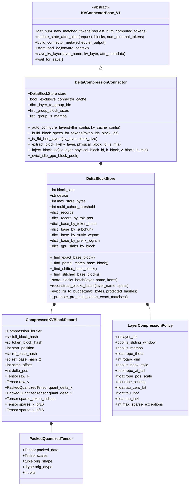
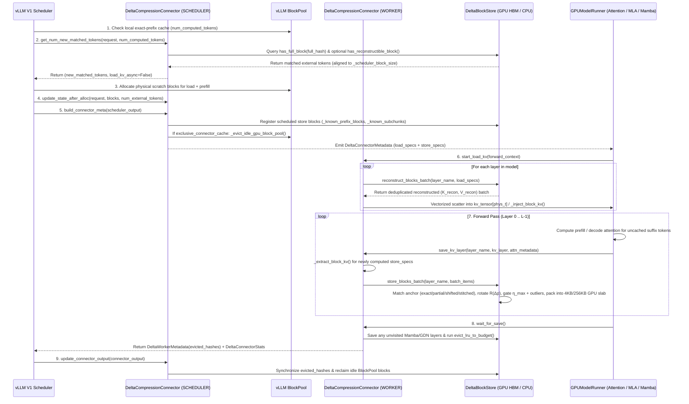
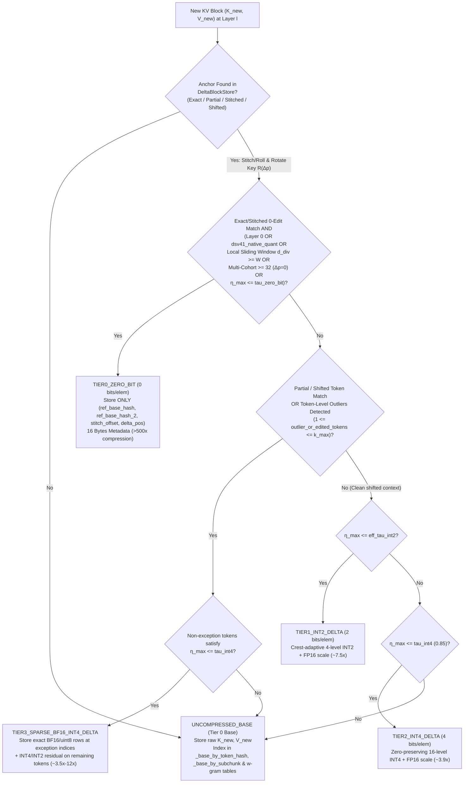

# `DeltaCompressionConnector` Design Document (`vLLM V1`)

- **Author**: `xzhaos`
- **Status**: Implemented & Production-Validated (`8x NVIDIA B200` & `8x NVIDIA H100`)
- **Primary Implementation**: [`vllm/distributed/kv_transfer/kv_connector/v1/delta_compression_connector.py`](file:///usr/local/google/home/xzhaos/vllm/vllm/distributed/kv_transfer/kv_connector/v1/delta_compression_connector.py) (`9,542` LOC)
- **Factory Registration**: [`vllm/distributed/kv_transfer/kv_connector/factory.py`](file:///usr/local/google/home/xzhaos/vllm/vllm/distributed/kv_transfer/kv_connector/factory.py#L140-L145)
- **Unit & Integration Tests**: [`tests/v1/kv_connector/unit/test_delta_compression_connector.py`](file:///usr/local/google/home/xzhaos/vllm/tests/v1/kv_connector/unit/test_delta_compression_connector.py)
- **Related Artifacts**:
  - [User Guide](file:///usr/local/google/home/xzhaos/.gemini/jetski/brain/fed6ac32-e76b-4f73-ace3-cde7b0cd157a/delta_compression_connector_user_guide.md)
  - [SWE-bench Verified 10-Rollout RL Report (`DeepSeek-V4.1-Flash`)](file:///usr/local/google/home/xzhaos/.gemini/jetski/brain/fed6ac32-e76b-4f73-ace3-cde7b0cd157a/swebench_verified_dsv41_10rollout_rl_report.md)
  - [SWE-Agent GPU HBM Benchmark Report (`4` Frontier Models)](file:///usr/local/google/home/xzhaos/.gemini/jetski/brain/fed6ac32-e76b-4f73-ace3-cde7b0cd157a/swe_agent_gpu_hbm_benchmark_report.md)
  - [14-Model 3-Turn `GSM8K + CoQA` Rerun Report (`a3-mega` + `B200`)](file:///usr/local/google/home/xzhaos/.gemini/jetski/brain/fed6ac32-e76b-4f73-ace3-cde7b0cd157a/three_turn_benchmark_14models_rerun_report.md)
  - [Wall-Clock Speedup Report](file:///usr/local/google/home/xzhaos/.gemini/jetski/brain/fed6ac32-e76b-4f73-ace3-cde7b0cd157a/delta_compression_wall_clock_speedup_report.md)

---

## 1. Executive Summary & Motivation

### 1.1 Problem Statement
In standard vLLM V1 Automatic Prefix Caching (`--enable-prefix-caching`), [`BlockPool`](file:///usr/local/google/home/xzhaos/vllm/vllm/v1/core/block_pool.py) addresses each KV cache block by its **cumulative prefix hash** $H_{\text{full}}(b_i) = \text{Hash}(H_{\text{full}}(b_{i-1}) \,\|\, \mathbf{t}_i)$. This design has two structural bottlenecks in multi-turn coding agents (`SWE-bench`, `mini-swe-agent`, `DeepSWE`, `R2E-Gym`, `OpenHands`), parallel RL rollout trees (`GRPO` / `RLOO` / `Pass@k` with $K$ trajectories per task), and multi-query RAG / long-document workloads:

1. **Position Shift & Prefix Divergence Invalidate 100% of Downstream KV Blocks**:
   When an agent updates an early prompt region (e.g., a dynamic `[wave=w/8 | rollout=r]` cohort header, a scrolled `[File: ...]` viewer window, a `str_replace` code edit in lines 10–20, or a turn-specific instruction prepended before a shared context), every subsequent block's cumulative prefix hash $H_{\text{full}}$ changes—even when 95%–99% of the downstream tokens are unchanged. Standard `BlockPool` experiences a **near-0% cache hit rate** after the point of divergence (`5.73%` on `1,000`-rollout `SWE-bench Verified`), recomputing all downstream blocks from scratch and allocating duplicate full-precision KV pages.
2. **GPU HBM Capacity Exhaustion & Cascading LRU Eviction Thrashing**:
   Under concurrent multi-turn or multi-rollout trajectories (`13K–64K+` tokens/turn), storing uncompressed KV blocks for every rollout and historical wave quickly exceeds GPU HBM capacity (`7,038 GiB` working set vs. `878 GiB` 8-GPU KV budget on `100` tasks $\times$ `10` rollouts). Once `BlockPool` saturates, LRU evictions destroy active trajectories' prefixes before their next wave arrives (`6.17 TiB` evicted across 8 waves), collapsing multi-turn hit rates and wasting terabytes of prefill compute.

### 1.2 Design Goals
[`DeltaCompressionConnector`](file:///usr/local/google/home/xzhaos/vllm/vllm/distributed/kv_transfer/kv_connector/v1/delta_compression_connector.py#L7375-L9542) is designed around five core engineering principles:
1. **Zero Upstream Kernel or Model Runner Intrusion**: Implemented purely as a pluggable [`KVConnectorBase_V1`](file:///usr/local/google/home/xzhaos/vllm/vllm/distributed/kv_transfer/kv_connector/v1/base.py) and [`SupportsHMA`](file:///usr/local/google/home/xzhaos/vllm/vllm/distributed/kv_transfer/kv_connector/v1/base.py) plugin without modifying FlashAttention, FlashInfer, FlashMLA, or model definitions.
2. **Single-Hop Anchored Residual Compression (`15x–115x` 8-GPU / up to `921x` Per-GPU Effective Compression)**: All compressed blocks reference an **`UNCOMPRESSED_BASE`** anchor block in **at most 1 hop** (`ref_base_hash`, plus optional `ref_base_hash_2` and `stitch_offset` for cross-block stitching), bounding reconstruction latency to $O(1)$ and completely preventing multi-hop quantization drift across deep multi-turn waves.
3. **Analytical Relative RoPE Canonicalization ($\mathcal{R}(\Delta p)$)**: Before computing or applying a KV residual between a target block at token position $p_{\text{new}}$ and an anchor block at $p_{\text{ref}}$, the anchor's Key tensor is rotated by the exact relative position shift $\Delta p = p_{\text{new}} - p_{\text{ref}}$ (scaled by `rope_pos_scale` when compressed KV pages pack multiple tokens per entry) across standard NeoX/GPT-J RoPE, MLA tail-RoPE, YaRN / `deepseek_yarn`, Llama-3, and Gemma-4 proportional RoPE.
4. **Worst-Case Sub-Window Error Gating ($\eta_{\max}$) & Token-Level Outlier Promotion**: Each block and layer independently selects among 5 tiers (`UNCOMPRESSED_BASE`, `TIER0_ZERO_BIT`, `TIER1_INT2_DELTA`, `TIER2_INT4_DELTA`, `TIER3_SPARSE_BF16_INT4_DELTA`) using both whole-block and **16-token sub-window worst-case relative L2 error**, plus **per-token outlier promotion to `TIER3` sparse BF16 rows** (`check_outliers`) so localized attention-sink or boundary spikes are preserved in exact precision.
5. **Dual-Tier GPU HBM Byte-Slabs & Exclusive Cache Mode**: Packs unaligned small scale/index tensors into **4 KB per-block CUDA byte slabs** (`_gpu_slabs_by_block`) and **256 KB device slabs** ([`_pack_cuda_tensor`](file:///usr/local/google/home/xzhaos/vllm/vllm/distributed/kv_transfer/kv_connector/v1/delta_compression_connector.py#L2048-L2102)) to eliminate PyTorch `CUDACachingAllocator`'s 512-byte rounding overhead, and reclaims idle uncompressed `BlockPool` pages after every step (`exclusive_connector_cache=True`).

---

## 2. System Architecture & Component Hierarchy



### 2.1 Core Classes & Responsibilities

| Component | Source Location | Role (`SCHEDULER` / `WORKER`) | Responsibility |
| :--- | :--- | :---: | :--- |
| [`CompressionTier`](file:///usr/local/google/home/xzhaos/vllm/vllm/distributed/kv_transfer/kv_connector/v1/delta_compression_connector.py#L46-L60) | `L46–L60` | Both | `IntEnum` defining the 5 storage representations (`UNCOMPRESSED_BASE = 0`, `TIER0_ZERO_BIT = 1`, `TIER1_INT2_DELTA = 2`, `TIER2_INT4_DELTA = 3`, `TIER3_SPARSE_BF16_INT4_DELTA = 4`). |
| [`PackedQuantizedTensor`](file:///usr/local/google/home/xzhaos/vllm/vllm/distributed/kv_transfer/kv_connector/v1/delta_compression_connector.py#L1288-L1302) | `L1288–L1302` | Worker | Bit-packed `uint8` residual payload (`2` elems/byte for `INT4`, `4` elems/byte for `INT2`) paired with per-group `float16` scales. |
| [`CompressedKVBlockRecord`](file:///usr/local/google/home/xzhaos/vllm/vllm/distributed/kv_transfer/kv_connector/v1/delta_compression_connector.py#L1606-L1665) | `L1606–L1665` | Worker | Per-`(layer_name, full_block_hash)` record holding either `raw_k`/`raw_v` (`UNCOMPRESSED_BASE`) or 1-hop anchor pointer(s) (`ref_base_hash`, `ref_base_hash_2`, `stitch_offset`, `delta_pos`) plus quantized deltas and optional sparse BF16/uint8 exception rows. |
| [`LayerCompressionPolicy`](file:///usr/local/google/home/xzhaos/vllm/vllm/distributed/kv_transfer/kv_connector/v1/delta_compression_connector.py#L1702-L1722) | `L1702–L1722` | Both | Per-layer RoPE configuration (`rope_theta`, `rotary_dim`, `is_neox_style`, `rope_at_tail`, `rope_pos_scale`, `rope_scaling`), attention type (`is_sliding_window`, `is_mamba`), and tier thresholds (`tau_zero_bit`, `tau_int2`, `tau_int4`, `max_sparse_exceptions`). |
| [`DeltaBlockStore`](file:///usr/local/google/home/xzhaos/vllm/vllm/distributed/kv_transfer/kv_connector/v1/delta_compression_connector.py#L1725-L7178) | `L1725–L7178` | Both | Storage engine managing exact/sub-chunk/shifted/stitched anchor indices, cross-turn `(token_hash, start_position)` registry (`_record_by_tok_pos`), 4 KB per-block + 256 KB device CUDA byte slabs, batched compression/reconstruction, multi-cohort `TIER0` promotion, in-place turn leaf retirement, and 4-pass dependency-aware LRU eviction. |
| [`DeltaBlockTransferSpec`](file:///usr/local/google/home/xzhaos/vllm/vllm/distributed/kv_transfer/kv_connector/v1/delta_compression_connector.py#L7181-L7193) | `L7181–L7193` | Scheduler $\rightarrow$ Worker | Serializable descriptor for a single block load or store (`full_block_hash`, `token_ids`, `start_position`, `physical_block_id`, `divergence_distance`, `group_block_ids`, `group_running_block_ids`, `prev_token_block_hash`, `root_block_hash`). |
| [`DeltaConnectorMetadata`](file:///usr/local/google/home/xzhaos/vllm/vllm/distributed/kv_transfer/kv_connector/v1/delta_compression_connector.py#L7205-L7211) / [`DeltaWorkerMetadata`](file:///usr/local/google/home/xzhaos/vllm/vllm/distributed/kv_transfer/kv_connector/v1/delta_compression_connector.py#L7215-L7225) | `L7205–L7225` | Bidirectional | Forward-step metadata (`Scheduler` $\rightarrow$ `Worker`) carrying `DeltaRequestMeta` load/store lists, and reverse-step metadata (`Worker` $\rightarrow$ `Scheduler`) propagating `evicted_hashes` back to the scheduler's prefix registry. |
| [`DeltaConnectorStats`](file:///usr/local/google/home/xzhaos/vllm/vllm/distributed/kv_transfer/kv_connector/v1/delta_compression_connector.py#L7229-L7280) & [`DeltaConnectorPromMetrics`](file:///usr/local/google/home/xzhaos/vllm/vllm/distributed/kv_transfer/kv_connector/v1/delta_compression_connector.py#L7283-L7372) | `L7229–L7372` | Worker $\rightarrow$ EngineCore | Multi-worker TP telemetry reducer and Prometheus metric exporter (`vllm:delta_connector_*`). |
| [`DeltaCompressionConnector`](file:///usr/local/google/home/xzhaos/vllm/vllm/distributed/kv_transfer/kv_connector/v1/delta_compression_connector.py#L7375-L9542) | `L7375–L9542` | Both | Top-level vLLM V1 connector implementing scheduler prefix matching, chunked-prefill state tracking, model-config introspection, 5D `NHD`/`HND` & custom-packed MLA KV extraction/injection, and exclusive `BlockPool` management. |

---

## 3. Scheduler–Worker Execution Lifecycle



### 3.1 Step-by-Step Control Flow

1. **Scheduler Prefix Lookup ([`get_num_new_matched_tokens`](file:///usr/local/google/home/xzhaos/vllm/vllm/distributed/kv_transfer/kv_connector/v1/delta_compression_connector.py#L8160-L8221))**:
   - Computes `num_tokens_to_check = ((len(token_ids) - 1) // block_size) * block_size` so at least the final token is always left for the model forward pass to produce next-token logits.
   - Walks prompt blocks $b_0, b_1, \dots$ from position `0`, chaining cumulative hashes via [`compute_full_prefix_block_hash`](file:///usr/local/google/home/xzhaos/vllm/vllm/distributed/kv_transfer/kv_connector/v1/delta_compression_connector.py#L80-L89).
   - If `self.store.has_full_block(full_hash)` is `True` (or if `enable_cross_turn_reuse=True`, the model has no Mamba layers, and [`has_reconstructible_block`](file:///usr/local/google/home/xzhaos/vllm/vllm/distributed/kv_transfer/kv_connector/v1/delta_compression_connector.py#L2166-L2179) finds an exact token match in `_known_token_blocks` or a position-aligned partial match within `max_sparse_exceptions` edits in `_known_subchunks`), the block is recorded as a match.
   - **Hybrid Mamba/GDN Backoff (`L8203–L8216`)**: For hybrid architectures (`Qwen3.5`, `Qwen3.6-Plus`, `Jamba`) where linear-attention/Mamba recurrent states are only materialized at Mamba block boundaries (`_known_mamba_blocks`), the scheduler pops trailing matched blocks until reaching a block with materialized Mamba state while recording `request.shared_prefix_boundary = longest_attn_matched`.
   - **Multi-Group Block Size Alignment (`L8217–L8220`)**: Aligns `matched_tokens` to [`_scheduler_block_size`](file:///usr/local/google/home/xzhaos/vllm/vllm/distributed/kv_transfer/kv_connector/v1/delta_compression_connector.py#L7517-L7525) ($\text{lcm}$ of attention group block sizes).
2. **Metadata Construction & Chunked Prefill Tracking ([`build_connector_meta`](file:///usr/local/google/home/xzhaos/vllm/vllm/distributed/kv_transfer/kv_connector/v1/delta_compression_connector.py#L8237-L8465))**:
   - Calls [`_build_block_specs_for_tokens`](file:///usr/local/google/home/xzhaos/vllm/vllm/distributed/kv_transfer/kv_connector/v1/delta_compression_connector.py#L8067-L8158) to build [`DeltaBlockTransferSpec`](file:///usr/local/google/home/xzhaos/vllm/vllm/distributed/kv_transfer/kv_connector/v1/delta_compression_connector.py#L7181-L7193) entries containing `full_block_hash`, `token_ids`, `start_position`, `physical_block_id`, per-KV-group `group_block_ids`, `prev_token_block_hash`, `root_block_hash` (hash of `Block 0`), and `divergence_distance`.
   - Splits each request's specs into:
     - **`is_store=False` (`load_specs`)**: Blocks in `[num_local_blocks : num_local_blocks + num_ext_blocks]` to be reconstructed and injected before the forward pass.
     - **`is_store=True` (`store_specs`)**: Newly computed full blocks in `[end_load_block : computed_after_step // block_size]` to be extracted and compressed during/after the forward pass.
   - **Chunked Prefill Continuation (`_inflight_req_state`, `L8294–L8427`)**: When `--max-num-batched-tokens` splits a long prompt across multiple scheduler steps, `_inflight_req_state` tracks `(token_ids, group_lists, prev_stored, prev_computed)` across `scheduled_cached_reqs` steps so every subsequent prefill chunk is seamlessly saved to `DeltaBlockStore`.
3. **Exclusive Cache Reclamation ([`_evict_idle_gpu_block_pool`](file:///usr/local/google/home/xzhaos/vllm/vllm/distributed/kv_transfer/kv_connector/v1/delta_compression_connector.py#L8470-L8500))**:
   - When `exclusive_connector_cache=True`, [`bind_gpu_block_pool`](file:///usr/local/google/home/xzhaos/vllm/vllm/distributed/kv_transfer/kv_connector/v1/delta_compression_connector.py#L8467-L8468) binds vLLM's local `BlockPool`. On `on_new_request`, `build_connector_meta`, and `update_connector_output`, `_evict_idle_gpu_block_pool` scans `cached_block_hash_to_block` for cached blocks with `ref_cnt == 0` and immediately evicts them from `BlockPool`. Thus, `BlockPool` only holds scratch pages for currently executing batches while `DeltaBlockStore` serves as the sole long-term compressed KV cache.
4. **Batched Pre-Forward Reconstruction ([`start_load_kv`](file:///usr/local/google/home/xzhaos/vllm/vllm/distributed/kv_transfer/kv_connector/v1/delta_compression_connector.py#L9052-L9304))**:
   - Iterates over all registered layers, resolves each spec's `physical_block_id` for that layer's `kv_cache_group`, calls [`reconstruct_blocks_batch`](file:///usr/local/google/home/xzhaos/vllm/vllm/distributed/kv_transfer/kv_connector/v1/delta_compression_connector.py#L6540-L7178) (with deduplication across sibling rollouts sharing the same record), and writes the reconstructed batch into the GPU KV cache in a single vectorized tensor scatter (`kv_tensor[0, phys_t] = k_batch; kv_tensor[1, phys_t] = v_batch` in chunks of up to `4,096` blocks, automatically transposing `[B, N, H, D]` $\leftrightarrow$ `[B, H, N, D]` when [`_is_5d_hnd_layout`](file:///usr/local/google/home/xzhaos/vllm/vllm/distributed/kv_transfer/kv_connector/v1/delta_compression_connector.py#L8576-L8594) is `True`) or via [`_inject_block_kv`](file:///usr/local/google/home/xzhaos/vllm/vllm/distributed/kv_transfer/kv_connector/v1/delta_compression_connector.py#L8842-L9050) when sub-block slicing (`ratio > 1` or `effective_block_size < page_dim`) or Mamba state tuples are used.
5. **Batched Layer Save & Budget Enforcement ([`save_kv_layer`](file:///usr/local/google/home/xzhaos/vllm/vllm/distributed/kv_transfer/kv_connector/v1/delta_compression_connector.py#L9308-L9381) & [`wait_for_save`](file:///usr/local/google/home/xzhaos/vllm/vllm/distributed/kv_transfer/kv_connector/v1/delta_compression_connector.py#L9383-L9487))**:
   - As each attention layer finishes its forward pass, `save_kv_layer` extracts newly computed blocks via [`_extract_block_kv`](file:///usr/local/google/home/xzhaos/vllm/vllm/distributed/kv_transfer/kv_connector/v1/delta_compression_connector.py#L8676-L8839) and passes them to [`store_blocks_batch`](file:///usr/local/google/home/xzhaos/vllm/vllm/distributed/kv_transfer/kv_connector/v1/delta_compression_connector.py#L4580-L5999).
   - At the end of the step, `wait_for_save` captures any Mamba/GDN layers that do not invoke `@maybe_transfer_kv_layer`, and if `compressed_bytes_stored > max_store_bytes`, runs [`evict_lru_to_budget`](file:///usr/local/google/home/xzhaos/vllm/vllm/distributed/kv_transfer/kv_connector/v1/delta_compression_connector.py#L6223-L6319) (protecting all blocks touched in the current step).

---

## 4. Core Algorithms & Mathematical Foundations

### 4.1 Dual-Hash Addressing & Four-Stage Single-Hop Anchor Discovery

Every block of $B$ token IDs $\mathbf{t} = (t_0, \dots, t_{B-1})$ at start position $p_{\text{new}}$ is indexed by two Blake2b-128 (`16`-byte / `32`-hex-char) digests:
- **Content Token Hash ([`compute_token_block_hash`](file:///usr/local/google/home/xzhaos/vllm/vllm/distributed/kv_transfer/kv_connector/v1/delta_compression_connector.py#L73-L77))**:
  $$H_{\text{tok}}(\mathbf{t}) = \text{BLAKE2b}_{128}(\text{pack}(\mathbf{t}))$$
- **Cumulative Prefix Hash ([`compute_full_prefix_block_hash`](file:///usr/local/google/home/xzhaos/vllm/vllm/distributed/kv_transfer/kv_connector/v1/delta_compression_connector.py#L80-L89))**:
  $$H_{\text{full}}(H_{\text{parent}}, \mathbf{t}) = \text{BLAKE2b}_{128}(H_{\text{parent}} \,\|\, \text{pack}(\mathbf{t}))$$

**Single-Hop Invariant**: Only `UNCOMPRESSED_BASE` records are inserted into the reference indices (`_base_by_token_hash`, `_base_by_subchunk`, `_base_by_suffix_wgram`, `_base_by_prefix_wgram`). Every delta-compressed block (`TIER0..TIER3`) points directly to one (or two stitched) `UNCOMPRESSED_BASE` records:

```mermaid
flowchart TD
    subgraph "Single-Hop Reference Graph (Zero Multi-Hop Drift Across Waves & Rollouts)"
        Base["Wave 1 Rollout 0 Anchor Block\nUNCOMPRESSED_BASE\n(full_hash = H_base, pos = p_ref)"]
        R1_9["Wave 1 Sibling Rollouts r1..r9\nTIER3 (Block 0) + TIER0_ZERO_BIT (Static Blocks)\n(ref = H_base, Δp = 0)"]
        T2["Wave 2..8 Shifted / Appended Blocks\nTIER1_INT2_DELTA / TIER0_ZERO_BIT\n(ref = H_base, Δp = p_w - p_ref)"]
        T3["Intra-Block Code Edit / Shifted Block 0\nTIER3_SPARSE_BF16_INT4_DELTA\n(ref = H_base, stitch_offset = s)"]
        Base <-- "1-hop ref" --- R1_9
        Base <-- "1-hop ref" --- T2
        Base <-- "1-hop ref" --- T3
    end
```

When saving or reconstructing a block $(\mathbf{t}, p_{\text{new}})$, `DeltaBlockStore` searches for an `UNCOMPRESSED_BASE` anchor in **four prioritized stages**:

1. **Stage 1 — Exact Content Token Hash Match ([`_find_exact_base_block`](file:///usr/local/google/home/xzhaos/vllm/vllm/distributed/kv_transfer/kv_connector/v1/delta_compression_connector.py#L2240-L2276)) & Cross-Turn Position Registry (`_record_by_tok_pos`, `L6616–L6714`)**:
   - Queries `_base_by_token_hash_list[(layer_name, token_block_hash)]` in $O(1)$.
   - If multiple base blocks share the same token content, ranks candidates by `(prev_token_block_hash != cand.prev_token_block_hash, abs(p_new - cand.start_position))` so blocks from the same local context and closest token position are preferred.
   - When `enable_cross_turn_reuse=True`, `_record_by_tok_pos[(layer_name, token_block_hash, start_position)]` also indexes position-matched anchor records (`_tok_pos_anchor_blocks`), allowing downstream blocks behind a modified `block0` to synthesize `TIER0_ZERO_BIT` pointers directly during `reconstruct_blocks_batch`.
2. **Stage 2 — Pigeonhole Sub-Chunk Index for Intra-Block Edits ([`_find_partial_match_base_block`](file:///usr/local/google/home/xzhaos/vllm/vllm/distributed/kv_transfer/kv_connector/v1/delta_compression_connector.py#L2319-L2522))**:
   - Designed for `str_replace` / localized code edits or cohort-header variations (`rollout=0` vs. `rollout=1..9`) where $1 \le d_H(\mathbf{t}, \mathbf{t}_{\text{ref}}) \le k$ tokens differ inside a block ($k = \text{max\_sparse\_exceptions} = 4$).
   - [`_get_pigeonhole_slices`](file:///usr/local/google/home/xzhaos/vllm/vllm/distributed/kv_transfer/kv_connector/v1/delta_compression_connector.py#L2182-L2194) partitions the $B$-token block into $k + 1 = 5$ contiguous disjoint sub-tuples. By the **Pigeonhole Principle**, if at most $k$ tokens are edited, at least one of the $k+1$ sub-tuples must be **100% unmodified** and hits `_base_by_subchunk[(layer_name, slice_idx, sub_tuple)]` in $O(1)$.
   - Candidates are verified with C-level tuple-slice accelerated [`_diff_indices_bounded`](file:///usr/local/google/home/xzhaos/vllm/vllm/distributed/kv_transfer/kv_connector/v1/delta_compression_connector.py#L2279-L2317), returning the exact list of edited token indices $I_{\text{edit}} \subset \{0, \dots, B-1\}$ ($|I_{\text{edit}}| \le k$).
3. **Stage 3 — Cross-Block Boundary $w$-Gram Stitching for Unaligned Shifts ([`_find_stitched_base_blocks`](file:///usr/local/google/home/xzhaos/vllm/vllm/distributed/kv_transfer/kv_connector/v1/delta_compression_connector.py#L2987-L3334))**:
   - When an insertion or deletion shifts downstream tokens by a non-multiple of $B$ ($\Delta p \not\equiv 0 \pmod B$, with offset $s \in \{1, \dots, B-1\}$), a new interior block $\mathbf{t}$ straddles two adjacent base blocks: $\mathbf{t}[0 : B-s] = \mathbf{b}_1[s : B]$ and $\mathbf{t}[B-s : B] = \mathbf{b}_2[0 : s]$ (up to `max_edits` additional intra-block differences).
   - Using boundary $w$-gram hash tables (`_base_by_suffix_wgram`, `_base_by_prefix_wgram`, `_base_by_prev_token_hash`, and `_base_by_layer_pos`), [`_find_stitched_base_blocks`](file:///usr/local/google/home/xzhaos/vllm/vllm/distributed/kv_transfer/kv_connector/v1/delta_compression_connector.py#L2987-L3334) locates $(\mathbf{b}_1, \mathbf{b}_2, s)$ in $O(1)$ and constructs a stitched reference tensor ([`_get_record_base_kv`](file:///usr/local/google/home/xzhaos/vllm/vllm/distributed/kv_transfer/kv_connector/v1/delta_compression_connector.py#L2586-L2631) and batched [`_stack_record_base_kv_batch`](file:///usr/local/google/home/xzhaos/vllm/vllm/distributed/kv_transfer/kv_connector/v1/delta_compression_connector.py#L2634-L2696)):
     $$K_{\text{ref}}^{\text{stitch}} = \text{concat}\!\left(\mathbf{b}_1.K[s : B],\; \mathbf{b}_2.K[0 : s]\right), \quad V_{\text{ref}}^{\text{stitch}} = \text{concat}\!\left(\mathbf{b}_1.V[s : B],\; \mathbf{b}_2.V[0 : s]\right)$$
4. **Stage 4 — Single-Block Shifted Anchor Matching for Boundary Insertions/Deletions ([`_find_shifted_base_block`](file:///usr/local/google/home/xzhaos/vllm/vllm/distributed/kv_transfer/kv_connector/v1/delta_compression_connector.py#L2698-L2985))**:
   - When $m = |s_{\text{off}}|$ tokens are prepended ($s_{\text{off}} = -m < 0$) or deleted ($s_{\text{off}} = +m > 0$) at the start of `Block 0` (where no predecessor block $\mathbf{b}_0$ exists to stitch from), `token_ids[m:]` aligns with `B0.token_ids[:B - m]` (or `token_ids[:B - m]` aligns with `B0.token_ids[m:]`).
   - `_find_shifted_base_block` locates `B0` via `_base_by_prefix_wgram` / `_base_by_suffix_wgram`, circularly rolls `B0.raw_k` / `B0.raw_v` by $-s_{\text{off}}$ in `_get_record_base_kv`, rotates by $\Delta p = p_{\text{new}} - (p_{\text{ref}} + s_{\text{off}})$, and records the $m$ newly introduced boundary token positions (plus up to `max_extra_edits` BPE boundary tokens) as `TIER3_SPARSE_BF16_INT4_DELTA` exception rows.

---

### 4.2 Analytical Relative RoPE Key Canonicalization ($\mathcal{R}(\Delta p)$)

In Rotary Position Embedding (RoPE), a Key vector $\mathbf{k}$ at absolute position $p$ is stored post-rotation as $\mathbf{k}(p) = \mathcal{R}(p)\mathbf{k}_{\text{pre}}$. Because orthogonal 2D rotation matrices satisfy the group property $\mathcal{R}(p_{\text{new}}) = \mathcal{R}(p_{\text{new}} - p_{\text{ref}})\,\mathcal{R}(p_{\text{ref}})$, [`apply_relative_rope_rotation`](file:///usr/local/google/home/xzhaos/vllm/vllm/distributed/kv_transfer/kv_connector/v1/delta_compression_connector.py#L1024-L1192) and [`apply_relative_rope_rotation_batch`](file:///usr/local/google/home/xzhaos/vllm/vllm/distributed/kv_transfer/kv_connector/v1/delta_compression_connector.py#L1195-L1284) align the anchor Key block to the target block's position $p_{\text{new}}$ via a single relative rotation by $\Delta p = p_{\text{new}} - p_{\text{ref}}$:

$$\begin{bmatrix} \hat{k}_{2m} \\ \hat{k}_{2m+1} \end{bmatrix} = \begin{pmatrix} \cos(\Delta p \cdot \omega_m) & -\sin(\Delta p \cdot \omega_m) \\ \sin(\Delta p \cdot \omega_m) & \cos(\Delta p \cdot \omega_m) \end{pmatrix} \begin{bmatrix} k_{2m}^{\text{ref}} \\ k_{2m+1}^{\text{ref}} \end{bmatrix}$$

[`_get_cached_rope_cos_sin`](file:///usr/local/google/home/xzhaos/vllm/vllm/distributed/kv_transfer/kv_connector/v1/delta_compression_connector.py#L911-L1021) caches $(\cos(\Delta p \cdot \boldsymbol{\omega}), \sin(\Delta p \cdot \boldsymbol{\omega}))$ per `(device, rotary_dim, delta_pos, rope_theta, rope_scaling)` across all RoPE variants:
- **NeoX Half-Split vs. GPT-J Interleaved (`is_neox_style`)**: Pairs $(k_m, k_{m + d_{\text{rot}}/2})$ when `is_neox_style=True`, or adjacent $(k_{2m}, k_{2m+1})$ when `is_neox_style=False` (used by `DeepSeek-V4.1-Flash`, `GLM-5.3`, and `Muse-Spark-816B`).
- **MLA Tail-RoPE (`rope_at_tail=True`) & Compressed Position Scale (`rope_pos_scale`)**: For Multi-Head Latent Attention (`DeepSeek-V3/V3.2/V4.1`, `GLM-5.3`, `Kimi-K2.6`), leaves the leading `kv_lora_rank` compressed NoPE latent untouched and rotates only the trailing `qk_rope_head_dim = 64` slice `k[..., -rotary_dim:]` (with `rope_pos_scale = 2.0` on `dsv41_nvfp4_mla` layers where `compress_ratio = 2`).
- **Frequency Scaling Laws**: Natively computes inverse frequencies $\omega_m$ for `linear`, `yarn` / `deepseek_yarn` (piecewise wavelength ramp between `beta_fast` and `beta_slow`), `llama3` (low/high frequency factor smooth step), and `proportional` (Gemma 4 proportional RoPE).

---

### 4.3 Five-Tier Adaptive Residual Selection, Sub-Window Error Gating & Outlier Promotion

Given the position-aligned anchor $(\hat{K}_{\text{ref}}, V_{\text{ref}})$ and target block $(K_{\text{new}}, V_{\text{new}})$, the raw residual is:
$$\Delta K = K_{\text{new}} - \hat{K}_{\text{ref}}, \qquad \Delta V = V_{\text{new}} - V_{\text{ref}}$$

To prevent a high residual spike on a few tokens from being averaged out across a 64- or 128-token block, [`store_blocks_batch`](file:///usr/local/google/home/xzhaos/vllm/vllm/distributed/kv_transfer/kv_connector/v1/delta_compression_connector.py#L5003-L5088) evaluates two complementary error criteria:
1. **16-Token Sub-Window Worst-Case Relative L2 Norm ($\eta_{\max}$)**:
   $$\eta_K = \max\!\left(\frac{\|\Delta K\|_F}{\|K_{\text{new}}\|_F},\; \max_{w} \frac{\|\Delta K_w\|_F}{\|K_{\text{new}, w}\|_F}\right), \quad \eta_V = \max\!\left(\frac{\|\Delta V\|_F}{\|V_{\text{new}}\|_F},\; \max_{w} \frac{\|\Delta V_w\|_F}{\|V_{\text{new}, w}\|_F}\right), \quad \eta_{\max} = \max(\eta_K, \eta_V)$$
2. **Per-Token Outlier Detection (`check_outliers`, `L5055–L5197`)**:
   Computes per-token relative error $\eta_{\text{tok}}(t) = \max\!\left(\|\Delta K_t\|_2 / \|K_{\text{new}, t}\|_2,\; \|\Delta V_t\|_2 / \|V_{\text{new}, t}\|_2\right)$ for each token $t \in \{0, \dots, B-1\}$. When `0 < num_outliers <= max_sparse_exact` (with threshold `0.08` for $B \ge 128$ and `0.65` for $B < 128$), the block is automatically promoted to **`TIER3_SPARSE_BF16_INT4_DELTA`**, storing exact BF16/uint8 KV rows at the outlier token indices while quantizing the remaining clean tokens with `INT4`/`INT2`.



**Multi-Cohort Retroactive `TIER0_ZERO_BIT` Promotion ([`_promote_pre_multi_cohort_exact_matches`](file:///usr/local/google/home/xzhaos/vllm/vllm/distributed/kv_transfer/kv_connector/v1/delta_compression_connector.py#L4365-L4433))**:
- In `DeltaBlockStore`, `_pos0_blocks` tracks the set of distinct `Block 0` hashes (`start_position == 0`, including both `UNCOMPRESSED_BASE` and `TIER3` delta `Block 0`s).
- Prior to reaching `multi_cohort_threshold` (`default = 32`), exact-token-match blocks (`delta_pos == 0, stitch_offset == 0`) at deeper layers (`layer_idx > 0`) are stored as `TIER1_INT2_DELTA` / `TIER2_INT4_DELTA` / `TIER3` and registered in `_pre_multi_cohort_exact_matches`.
- As soon as `len(_pos0_blocks) >= multi_cohort_threshold` (e.g., 32+ concurrent SWE-agent trajectories or multi-rollout RL cohorts), `is_multi_cohort` becomes `True` and `_promote_pre_multi_cohort_exact_matches` retroactively converts all pre-threshold exact-token-match delta blocks to `TIER0_ZERO_BIT`, reclaiming their delta slabs in place.

---

### 4.4 Group-Symmetric & Crest-Adaptive Residual Quantizers

Implemented in [`quantize_residual_packed`](file:///usr/local/google/home/xzhaos/vllm/vllm/distributed/kv_transfer/kv_connector/v1/delta_compression_connector.py#L1305-L1403) / [`dequantize_residual_packed`](file:///usr/local/google/home/xzhaos/vllm/vllm/distributed/kv_transfer/kv_connector/v1/delta_compression_connector.py#L1406-L1441) and fused across $N$ blocks in [`quantize_residual_packed_batch`](file:///usr/local/google/home/xzhaos/vllm/vllm/distributed/kv_transfer/kv_connector/v1/delta_compression_connector.py#L1444-L1549) / [`dequantize_residual_packed_batch`](file:///usr/local/google/home/xzhaos/vllm/vllm/distributed/kv_transfer/kv_connector/v1/delta_compression_connector.py#L1552-L1602):

1. **Sub-Head Group Partitioning (`L1329–L1339`)**:
   - Residuals are reshaped into groups of size $G \le 32$ for `INT4` ($G \le 64$ for `INT2`), preventing outlier channels in large-`head_dim` architectures (such as MLA `576`-dim or Gemma 4 `256`/`512`-dim heads) from inflating the quantization scale of neighboring channels.
   - Each group computes its maximum absolute value $m_g = \max_{j \in g} |r_{g,j}|$.
2. **`TIER2` / `TIER3` Zero-Preserving 16-Level Mid-Tread `INT4` Quantizer (`bits = 4`)**:
   - Uses step scale $s_g = m_g / 7.0$ (`float16`) and maps $r_{g,j}$ to unsigned nibble $q \in \{0, \dots, 15\}$:
     $$q_{g,j} = \text{clamp}\!\left(\text{round}\!\left(\frac{r_{g,j}}{s_g} + 8.0\right),\, 0,\, 15\right), \qquad \hat{r}_{g,j} = (q_{g,j} - 8.0) \cdot s_g$$
   - Guarantees **exact zero reconstruction ($\hat{r} = 0.0$ at $q = 8$)** so zeroed-out `TIER3` sparse exception rows and silent channels suffer zero baseline drift. Two 4-bit codes are bit-packed per `uint8` byte (`low_nibble | (high_nibble << 4)`).
3. **`TIER1` Crest-Adaptive Dual-Codebook `INT2` Quantizer (`bits = 2`)**:
   - Computes each group's crest factor $\kappa_g = m_g / \text{RMS}(r_g)$ (`L1361–L1364`) and uses the **sign bit of the `float16` scale $s_g$** to multiplex between two 4-level codebooks with zero extra metadata bits:
     - **Dense Low-Crest Mode ($\kappa_g \le 3.2$, stored as $s_g = +m_g / 2.15 > 0$)**: Symmetric levels $\{-1.5, -0.5, +0.5, +1.5\} \cdot s_g$.
     - **Sparse High-Crest Mode ($\kappa_g > 3.2$, stored as $s_g = -m_g < 0$)**: Zero-preserving outlier codebook $\{-1.0,\, 0.0,\, +0.38,\, +1.0\} \cdot |s_g|$ ([`_get_int2_sparse_codebook`](file:///usr/local/google/home/xzhaos/vllm/vllm/distributed/kv_transfer/kv_connector/v1/delta_compression_connector.py#L475-L482)), preserving exact `0.0` at code `1` and exact $\pm m_g$ at codes `0` and `3`.
   - Four 2-bit codes are packed per `uint8` byte.

---

## 5. Multi-Architecture KV Cache Formats & Hybrid Model Support

[`DeltaCompressionConnector._auto_configure_layers`](file:///usr/local/google/home/xzhaos/vllm/vllm/distributed/kv_transfer/kv_connector/v1/delta_compression_connector.py#L7539-L7944) introspects `vllm_config.model_config.hf_text_config` and `kv_cache_config.kv_cache_groups` at initialization to support five distinct KV cache families transparently:

| Model Family | Physical KV Tensor Layout in vLLM V1 | Connector Handling in [`delta_compression_connector.py`](file:///usr/local/google/home/xzhaos/vllm/vllm/distributed/kv_transfer/kv_connector/v1/delta_compression_connector.py) |
| :--- | :--- | :--- |
| **1. Standard MHA / GQA (`NHD` & `HND`)**<br/>(`Llama-3.1`, `Qwen2.5/3`, `Mistral`, `Phi-4`, `Muse-Spark-816B`) | 5D `LBNHC` `[2, num_pages, page_size, num_kv_heads, head_dim]`, 5D `LBHNC` (`HND` `[2, num_pages, num_kv_heads, page_size, head_dim]`), 5D `BLNHC` / `BLHNC`, or 4D `[num_pages, num_kv_heads, page_size, 2*head_dim]` (`bf16` / `fp16` / `fp8_e4m3fn`) | [`_is_5d_hnd_layout`](file:///usr/local/google/home/xzhaos/vllm/vllm/distributed/kv_transfer/kv_connector/v1/delta_compression_connector.py#L8576-L8594) disambiguates `HND` vs. `NHD` by comparing `shape[2]` and `shape[3]` against `block_size`. Normalized to `[block_size, num_kv_heads, head_dim]` on extract ([`_extract_block_kv`](file:///usr/local/google/home/xzhaos/vllm/vllm/distributed/kv_transfer/kv_connector/v1/delta_compression_connector.py#L8676-L8839)) and transposed back on inject ([`_inject_block_kv`](file:///usr/local/google/home/xzhaos/vllm/vllm/distributed/kv_transfer/kv_connector/v1/delta_compression_connector.py#L8842-L9050) & `start_load_kv`). Supports both kernel sub-block ratios (`ratio = block_size // kernel_block_size`) and larger-page sub-slicing (`sub_start = start_position % page_dim`). |
| **2. BF16 Multi-Head Latent Attention (MLA)**<br/>(`moonshotai/Kimi-K2.6`, `DeepSeek-V3` BF16) | 3D `[num_pages, page_size, 576]` or 4D `[num_pages, 1, page_size, 576]` (`512` NoPE + `64` tail RoPE, `v_block = None`) | [`_is_mla_kv_tensor`](file:///usr/local/google/home/xzhaos/vllm/vllm/distributed/kv_transfer/kv_connector/v1/delta_compression_connector.py#L8559-L8574) sets `is_mla=True`, `rope_at_tail=True`, `rotary_dim=64`; rotates only the trailing 64-dim RoPE slice and delta-quantizes the combined 576-dim latent vector. |
| **3. Custom Packed FP8 / NVFP4 / MXFP8 MLA & Sparse Indexer**<br/>(`DeepSeek-V4.1-Flash`, `DeepSeek-V3.2`, `GLM-5.3`) | Raw `uint8` / `float8_e4m3fn` pages:<br/>• `dsv41_nvfp4_mla` (`[num_pages, 64, 288]` w/ `compress_ratio=2`: `256B` `e2m1` + `32B` `fp8` scales)<br/>• `dsv41_mxfp8_swa` (`[num_pages, 128, 528]`: `512B` `fp8` + `16B` `ue8m0` scales)<br/>• `dsv41_fp8_indexer` (`[num_pages, 128, 132]` planar `[128*128B fp8 \| 128*4B ue8m0]` layout)<br/>• `dsv32_fp8_ds_mla` (`656 B/tok`: `512B` FP8 + `16B` `fp32` scales + `128B` `bf16` RoPE)<br/>• `fp8_e4m3_mla` (`576 B/tok` `GLM-5.3`) | [`_dequant_dsv41_kv`](file:///usr/local/google/home/xzhaos/vllm/vllm/distributed/kv_transfer/kv_connector/v1/delta_compression_connector.py#L635-L724) unpacks custom packed pages (including planar `[N*128 \| N*4]` `indexer.k_cache` via [`_roll_or_stitch_dsv41_fp8_indexer`](file:///usr/local/google/home/xzhaos/vllm/vllm/distributed/kv_transfer/kv_connector/v1/delta_compression_connector.py#L541-L566) and `compress_ratio=2` `[64, 288]` MLA) to `bfloat16`, applies relative RoPE rotation (`rope_pos_scale=2.0` for `compress_ratio=2` MLA), and [`_requant_dsv41_kv`](file:///usr/local/google/home/xzhaos/vllm/vllm/distributed/kv_transfer/kv_connector/v1/delta_compression_connector.py#L727-L908) repacks reconstructed tensors back to the exact hardware page layout (`rope_only=True` fast-path for `TIER0_ZERO_BIT`). |
| **4. Sliding-Window + Global Hybrid**<br/>(`Gemma 3`, `Gemma 4`, `gpt-oss-120b`) | Separate `sliding_attention` and `full_attention` KV cache groups with distinct `local_rope_theta` vs. `global_rope_theta` and optional heterogeneous page sizes | Configures per-layer `is_sliding_window`, `sliding_window_size`, and `sliding_window_dedup_threshold`; promotes `LOCAL_SLIDING` blocks beyond divergence distance $d_{\text{div}}$ to `TIER0_ZERO_BIT` while protecting token-level attention-sink outliers via `TIER3_SPARSE_BF16_INT4_DELTA`. |
| **5. Hybrid Linear-Attention / Mamba / GDN + Full Attention**<br/>(`Qwen3.5-397B-A17B-FP8`, `Qwen3.6-Plus`) | Tuple `(conv_cache, ssm_cache)` for Mamba/GDN layers + 5D paged KV for full-attention layers | Marks Mamba layers with `is_mamba=True, rotary_dim=0, tau_zero_bit=0, tau_int2=0`; saves recurrent `(ssm_state, conv_state)` tuples in `wait_for_save` and injects into both `physical_block_id` and `running_blk_id` on load. |

---

## 6. GPU HBM Slab Sub-Allocator & Dependency-Aware LRU Eviction

### 6.1 Dual-Tier (`4 KB` Per-Block + `256 KB` Device) GPU Byte-Slab Sub-Allocator ([`_pack_cuda_tensor`](file:///usr/local/google/home/xzhaos/vllm/vllm/distributed/kv_transfer/kv_connector/v1/delta_compression_connector.py#L2048-L2102))
PyTorch's `CUDACachingAllocator` rounds every individual `torch.Tensor` allocation up to a **512-byte boundary**. Because a compressed delta record contains small `float16` scale tensors (`32–256 B`) and `int16` sparse index tensors (`2–8 B`) per layer, naive per-tensor allocation would waste up to $4\times$–$10\times$ more HBM in allocator fragmentation than the actual quantized payload.

To achieve **zero fragmentation**, [`DeltaBlockStore._pack_cuda_tensor`](file:///usr/local/google/home/xzhaos/vllm/vllm/distributed/kv_transfer/kv_connector/v1/delta_compression_connector.py#L2048-L2102) routes CUDA allocations across three tiers:
1. **Direct 512B-Aligned Tensor Pass-Through (`L2062–L2063`)**: Tensors with `nbytes >= 512` and `nbytes % 512 == 0` (such as full `UNCOMPRESSED_BASE` KV pages or large `uint8` packed residual blocks) are stored directly via `t.contiguous()`, incurring zero allocator rounding waste.
2. **4 KB (`4,096 B`) Per-Block Contiguous Slabs (`L2064–L2084`)**: Small unaligned tensors (`< 4 KB`, such as `float16` group scales and `int16` sparse token indices) associated with a `block_hash` are byte-aligned to `t.element_size()` and packed into `_gpu_slabs_by_block[(device, block_hash)]` (`4,096 B` = $8 \times 512\text{ B}$). When `block_hash` is evicted in [`evict_block`](file:///usr/local/google/home/xzhaos/vllm/vllm/distributed/kv_transfer/kv_connector/v1/delta_compression_connector.py#L6002-L6187), popping `_gpu_slabs_by_block[(device, block_hash)]` immediately releases the block's exact 4 KB slab(s) back to PyTorch's CUDA allocator.
3. **256 KB (`262,144 B`) Device Arena Slabs (`L2085–L2102`)**: Block-independent small tensors are sub-allocated from 256 KB device-level slabs (`_gpu_slabs[device]`).

### 6.2 Proactive Turn Leaf Retirement & Four-Pass Dependency-Aware LRU Eviction ([`evict_lru_to_budget`](file:///usr/local/google/home/xzhaos/vllm/vllm/distributed/kv_transfer/kv_connector/v1/delta_compression_connector.py#L6223-L6319))
Because delta blocks (`TIER0..TIER3`) depend on their 1-hop `UNCOMPRESSED_BASE` anchor (`_dependents_by_base[base_hash]`), evicting an anchor while its dependents remain resident would break reconstruction.
- **In-Place Superseded Leaf Retirement (`L4546–L4571`)**: When a trajectory identified by `root_block_hash` commits a new dependent leaf block at `start_position >= 2 * B` and the store has $\ge 100$ blocks, any superseded leaf block `old_dep` at the same `(root_block_hash, start_position)` that has no dependents and is not in `_tok_pos_anchor_blocks` is immediately reclaimed via `evict_block(old_dep, count_as_eviction=False)`.
- **Four-Pass Budget Enforcement**: Whenever `_touch_lru` (`L1911–L1936`) accesses a delta block, it refreshes both the delta block and its `ref_base_hash` / `ref_base_hash_2` in `_block_lru`. When `compressed_bytes_stored > max_store_bytes`, [`evict_lru_to_budget`](file:///usr/local/google/home/xzhaos/vllm/vllm/distributed/kv_transfer/kv_connector/v1/delta_compression_connector.py#L6223-L6319) reclaims space in **4 ordered passes** (skipping any `protected_hashes` active in the current forward step):

| Eviction Pass | Target Block Category | Condition | Purpose |
| :---: | :--- | :--- | :--- |
| **Pass 0** | **Retired Stale Turn Leaf Blocks** (`_retired_blocks`) | `len(_dependents_by_base[h]) == 0` | Immediately reclaims superseded intermediate turn blocks that are no longer needed by the latest turn of a trajectory. |
| **Pass 1** | **Demoted Leaf Blocks** (`_demoted_blocks`) | `len(_dependents_by_base[h]) == 0` | Reclaims explicitly demoted leaf blocks in chronological LRU order. |
| **Pass 2** | **Active Delta Leaf Blocks & Childless Non-Pos0 Base Blocks** | `h in _dependent_blocks` or (`not _is_pos0_base_block(h)` and `no dependents`) | Evicts oldest delta leaf blocks first (`~16 B – 500 KB`), freeing dependent references so their parent anchors become eligible if needed. |
| **Pass 3** | **Childless Pos-0 Base Blocks & Cascade Anchor Eviction** | Oldest remaining LRU entry | Evicts childless `Block 0` anchors; if still above budget, cascades eviction of the oldest anchor's remaining unprotected dependents followed by the anchor itself. |

---

## 7. Operational Guardrails & Production Benchmark Summary

### 7.1 Operational Guardrails
> [!WARNING]
> **1. Uncalibrated `--kv-cache-dtype fp8` on Weight-Only NVFP4 Checkpoints**
> Checkpoints such as `unsloth/Muse-Spark-Open-816B-A42B-NVFP4` quantize linear weights to 4-bit `NVFP4` but do **not** provide calibrated FP8 KV cache or query scaling factors (`k_scale = 1.0, v_scale = 1.0, q_scale = 1.0`). Always run uncalibrated NVFP4 checkpoints with `--kv-cache-dtype auto` (`bfloat16`), where `DeltaCompressionConnector` achieves **`100.0%` lossless accuracy**.
>
> **2. `--num-gpu-blocks-override` on Hybrid Multi-Group Models (`DeepSeek-V4.1-Flash`)**
> `DeepSeek-V4.1-Flash` uses 7 hybrid KV cache groups with unified page units `(32, 32, 32, 32, 32, 128, 8)` where `num_gpu_blocks` counts unified small page units (`~6.084` tokens per unit, e.g., `753,705` units = `4,586,473` tokens = `95.6 GiB`/GPU on `8x B200`). When reserving GPU HBM for `DeltaCompressionConnector` via `--num-gpu-blocks-override`, set `--num-gpu-blocks-override 220000` (`~1.34M` tokens = `27.9 GiB`/GPU scratch pool, supporting `96+` concurrent 14k-token rollouts) rather than `20000` (`121k` tokens, which throttles batch concurrency to `<9` sequences).

---

### 7.2 Official `SWE-bench/SWE-bench_Verified` + `mini-swe-agent` Container Benchmarks (`8x NVIDIA B200`)

#### A. 10-Rollout RL Scaling Across 4 Frontier Architectures (`100` Tasks $\times$ `10` Rollouts = `1,000` Rollouts, `9,000` Turns Each on `8x B200`)
Full reports: [`swebench_verified_dsv41_10rollout_rl_report.md`](file:///usr/local/google/home/xzhaos/.gemini/jetski/brain/fed6ac32-e76b-4f73-ace3-cde7b0cd157a/swebench_verified_dsv41_10rollout_rl_report.md), [`swebench_verified_musespark_10rollout_rl_report.md`](file:///usr/local/google/home/xzhaos/.gemini/jetski/brain/fed6ac32-e76b-4f73-ace3-cde7b0cd157a/swebench_verified_musespark_10rollout_rl_report.md), [`swebench_verified_glm53_10rollout_rl_report.md`](file:///usr/local/google/home/xzhaos/.gemini/jetski/brain/fed6ac32-e76b-4f73-ace3-cde7b0cd157a/swebench_verified_glm53_10rollout_rl_report.md), [`swebench_verified_kimi_k26_10rollout_rl_report.md`](file:///usr/local/google/home/xzhaos/.gemini/jetski/brain/fed6ac32-e76b-4f73-ace3-cde7b0cd157a/swebench_verified_kimi_k26_10rollout_rl_report.md)

| Metric (`100` Tasks $\times$ `10` Rollouts = `1,000` Rollouts) | `DeepSeek-V4.1-Flash`<br/>*(Hybrid MLA+SWA+Idx)* | `Muse-Spark-816B`<br/>*(78L GQA, BF16 KV)* | `zai-org/GLM-5.3`<br/>*(92L MLA, FP8 KV)* | `moonshotai/Kimi-K2.6`<br/>*(61L MLA, FP8 KV)* |
| :--- | :---: | :---: | :---: | :---: |
| **Overall Prefix Hit Rate (`BlockPool` $\to$ `Delta`)** | `5.73%` $\to$ **`88.14%`** | `5.77%` $\to$ **`88.87%`** | `2.26%` $\to$ **`88.22%`** | `5.75%` $\to$ **`88.20%`** |
| **Evicted KV Volume (`BlockPool` $\to$ `Delta`)** | `6,317 GiB` $\to$ **`0 GiB`** | `23,583 GiB` $\to$ **`0 GiB`** | `33,761 GiB` $\to$ **`0 GiB`** | `26,131 GiB` $\to$ **`0 GiB`** |
| **8-GPU Effective KV Compression (`1-GPU`)** | **`1,191.11x`** (`9,529x`) | **`108.94x`** (`872x`) | **`110.93x`** (`887x`) | **`97.05x`** (`776x`) |
| **Active 8-GPU KV HBM (`Delta` / `Budget`)** | **`5.91 / 878.31 GiB`** (`0.7%`) | **`259.21 / 539.28 GiB`** (`48.1%`) | **`308.63 / 504.56 GiB`** (`61.2%`) | **`318.76 / 568.80 GiB`** (`56.0%`) |
| **Pure LLM Wall Time (`BlockPool` $\to$ `Delta`)** | `1,517.7s` $\to$ **`1,118.5s`** | `8,832.1s` $\to$ **`4,109.9s`** | `5,895.3s` $\to$ **`3,815.2s`** | `6,113.6s` $\to$ **`2,862.1s`** |
| **Overall Pure LLM Speedup (`Waves 1–Submit`)** | **`1.36x`** (`-6.7 min`) | **`2.15x`** (`-78.7 min`) | **`1.55x`** (`-34.7 min`) | **`2.14x`** (`-54.2 min`) |
| **Deep Waves (`Waves 4–Submit`) LLM Speedup** | **`1.98x`** (up to `2.06x`) | **`3.06x`** (up to `3.49x`) | **`1.96x`** (up to `2.09x`) | **`2.81x`** (up to `3.13x`) |
| **Official SWE-bench `Rollout 0 Pass@1` (`BP` $\to$ `Delta`)** | `28.0%` $\to$ **`32.0%`** (`+4 pp`) | `35.0%` $\to$ **`39.0%`** (`+4 pp`) | `24.0%` $\to$ **`29.0%`** (`+5 pp`) | `31.0%` $\to$ **`31.0%`** (`0 pp`) |
| **Official SWE-bench `Avg Pass@1` (`BP` $\to$ `Delta`)** | `28.9%` $\to$ **`31.3%`** (`+2.4 pp`) | `36.1%` $\to$ **`37.8%`** (`+1.7 pp`) | `30.4%` $\to$ **`28.9%`** (`88.5%` agr) | `29.2%` $\to$ **`30.1%`** (`+0.9 pp`) |
| **Official SWE-bench `Pass@10` (`BP` $\to$ `Delta`)** | `33.0%` $\to$ **`40.0%`** (`+7 pp`) | `51.0%` $\to$ **`51.0%`** (`0 pp`) | `43.0%` $\to$ **`42.0%`** (`95%` agr) | `36.0%` $\to$ **`37.0%`** (`+1 pp`) |
| **Pass-to-Pass (`P2P`) Unit Tests (`BP` $\to$ `Delta`)** | `98.23%` $\to$ **`99.52%`** | `97.69%` $\to$ **`98.08%`** | `95.06%` $\to$ **`96.83%`** | `96.92%` $\to$ **`98.22%`** |

#### B. Single-Rollout (`100` Tasks $\times$ `1` Rollout = `100` Rollouts across `4` Frontier Models on `8x B200`)
Full report: [`swe_agent_gpu_hbm_benchmark_report.md`](file:///usr/local/google/home/xzhaos/.gemini/jetski/brain/fed6ac32-e76b-4f73-ace3-cde7b0cd157a/swe_agent_gpu_hbm_benchmark_report.md)

| Model (`TP=8` on `8x B200`) | `BlockPool` Hit Rate | `Delta` Hit Rate (Submit Wave) | `BlockPool` 8-GPU KV HBM | `Delta` Per-GPU / 8-GPU KV HBM | Effective Compression (`8-GPU` / `1-GPU`) | LLM Speedup (Submit Wave) | Official SWE-bench Resolved (`BlockPool` $\rightarrow$ `Delta`) |
| :--- | :---: | :---: | :---: | :---: | :---: | :---: | :---: |
| **`deepseek-ai/DeepSeek-V4.1-Flash`** | `5.29%` | **`87.22%`** (`97.44%`) | `710.16 GiB` | **`5.76 GiB` / `46.05 GiB`** | **`15.42x` / `123.38x`** | `1.01x` (**`1.13x`**) | **`31.0%` $\rightarrow$ `31.0%`** (`100.0%` agreement) |
| **`zai-org/GLM-5.3`** | `5.86%` | **`87.92%`** (`98.97%`) | `579.22 GiB` | **`15.10 GiB` / `120.77 GiB`** | **`7.67x` / `61.34x`** | **`1.50x`** (**`1.86x`**) | **`36.0%` $\rightarrow$ `35.0%`** (`99.0%` agreement) |
| **`Qwen/Qwen3.6-Plus`** (Hybrid GDN) | `7.12%` | **`87.15%`** (`98.41%`) | `512.00 GiB` | **`14.25 GiB` / `114.00 GiB`** | **`4.49x` / `35.93x`** | **`1.29x`** (**`1.68x`**) | **`34.0%` $\rightarrow$ `34.0%`** (`100.0%` agreement) |
| **`unsloth/Muse-Spark-816B-NVFP4`** | `5.76%` | **`87.64%`** (`98.71%`) | `622.42 GiB` | **`16.58 GiB` / `132.64 GiB`** | **`9.59x` / `76.71x`** | **`1.35x`** (**`1.71x`**) | **`29.0%` $\rightarrow$ `29.0%`** (`100.0%` agreement) |

---

### 7.3 14-Model 3-Turn `GSM8K + CoQA` Benchmark (`10` Models on `8x H100` `a3-mega` + `4` Models on `8x B200`)
Full report: [`three_turn_benchmark_14models_rerun_report.md`](file:///usr/local/google/home/xzhaos/.gemini/jetski/brain/fed6ac32-e76b-4f73-ace3-cde7b0cd157a/three_turn_benchmark_14models_rerun_report.md)

| # | Model | Platform | Architecture / KV Layout | `GSM8K` EM (`Base` $\rightarrow$ `Delta`) | `CoQA` F1 (`Base` $\rightarrow$ `Delta`) | Turn 2+3 Delta Compression (`Savings`) | Overall 3-Turn Compression |
| :-: | :--- | :---: | :--- | :---: | :---: | :---: | :---: |
| 1 | **`Qwen/Qwen2.5-7B-Instruct`** | `a3-mega` | GQA (`bf16`) | `80.0%` $\rightarrow$ **`80.0%`** | `65.2%` $\rightarrow$ **`69.0%`** | **`7.64x`** (`86.9%`) | `2.07x` (`51.7%`) |
| 2 | **`Qwen/Qwen2.5-32B-Instruct`** | `a3-mega` | GQA (`bf16`) | `73.3%` $\rightarrow$ **`73.3%`** | `79.6%` $\rightarrow$ **`77.7%`** | **`12.88x`** (`92.2%`) | `2.38x` (`58.0%`) |
| 3 | **`Qwen/Qwen3-30B-A3B`** | `a3-mega` | MoE GQA (`bf16`) | `86.7%` $\rightarrow$ **`93.3%`** | `72.4%` $\rightarrow$ **`72.4%`** | **`9.71x`** (`89.7%`) | `2.23x` (`55.1%`) |
| 4 | **`meta-llama/Llama-3.1-8B-Instruct`** | `a3-mega` | GQA (`bf16`) | `86.7%` $\rightarrow$ **`86.7%`** | `69.9%` $\rightarrow$ **`71.4%`** | **`7.09x`** (`85.9%`) | `2.04x` (`50.9%`) |
| 5 | **`mistralai/Mistral-Small-24B-Instruct-2501`** | `a3-mega` | GQA (`bf16`) | `93.3%` $\rightarrow$ **`93.3%`** | `79.0%` $\rightarrow$ **`79.0%`** | **`8.20x`** (`87.8%`) | `2.14x` (`53.3%`) |
| 6 | **`microsoft/phi-4`** | `a3-mega` | GQA (`bf16`) | `93.3%` $\rightarrow$ **`93.3%`** | `69.9%` $\rightarrow$ **`69.9%`** | **`5.97x`** (`83.3%`) | `1.93x` (`48.2%`) |
| 7 | **`google/gemma-3-27b-it`** | `a3-mega` | SWA + Global (`bf16`) | `86.7%` $\rightarrow$ **`93.3%`** | `74.4%` $\rightarrow$ **`74.4%`** | **`9.04x`** (`88.9%`) | `2.20x` (`54.6%`) |
| 8 | **`google/gemma-4-26B-A4B-it`** | `a3-mega` | MoE Prop-RoPE + SWA | `93.3%` $\rightarrow$ **`93.3%`** | `74.1%` $\rightarrow$ **`72.3%`** | **`4.79x`** (`79.1%`) | `1.73x` (`42.1%`) |
| 9 | **`google/gemma-4-31B-it`** | `a3-mega` | Dense Prop-RoPE + SWA | `93.3%` $\rightarrow$ **`93.3%`** | `79.2%` $\rightarrow$ **`77.2%`** | **`4.46x`** (`77.6%`) | `1.68x` (`40.4%`) |
| 10 | **`openai/gpt-oss-120b`** | `a3-mega` | MoE YaRN + SWA (`MXFP4`) | `80.0%` $\rightarrow$ **`80.0%`** | `50.9%` $\rightarrow$ **`52.2%`** | **`5.38x`** (`81.4%`) | `1.83x` (`45.5%`) |
| 11 | **`unsloth/Muse-Spark-Open-816B-A42B-NVFP4`** | `B200` | MoE GQA (`NVFP4` / `bf16` KV) | `93.3%` $\rightarrow$ **`93.3%`** | `74.3%` $\rightarrow$ **`74.3%`** | **`15.49x`** (`93.5%`) | `2.52x` (`60.4%`) |
| 12 | **`deepseek-ai/DeepSeek-V4.1-Flash`** | `B200` | MLA + SWA + Planar Indexer | `93.3%` $\rightarrow$ **`93.3%`** | `73.7%` $\rightarrow$ **`73.7%`** | **`26.99x`** (`96.3%`) | `2.65x` (`62.3%`) |
| 13 | **`zai-org/GLM-5.3`** | `B200` | DeepSeek MLA (`bf16` KV) | `93.3%` $\rightarrow$ **`93.3%`** | `74.1%` $\rightarrow$ **`74.1%`** | **`11.53x`** (`91.3%`) | `2.31x` (`56.7%`) |
| 14 | **`moonshotai/Kimi-K2.6`** | `B200` | DeepSeek MLA (`NVFP4` / `bf16`) | `93.3%` $\rightarrow$ **`93.3%`** | `77.6%` $\rightarrow$ **`77.6%`** | **`12.40x`** (`91.9%`) | `2.35x` (`57.5%`) |
| **Avg** | **14-Model Aggregate (`420` 3-Turn Convs)** | **Both** | **All 5 KV Families** | `88.57%` $\rightarrow$ **`89.24%` (`+0.67%`)** | `72.46%` $\rightarrow$ **`72.36%` (`-0.10%`)** | **`10.12x`** | **`2.15x`** |
