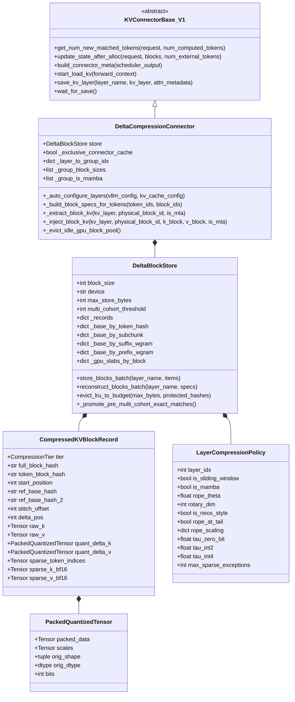
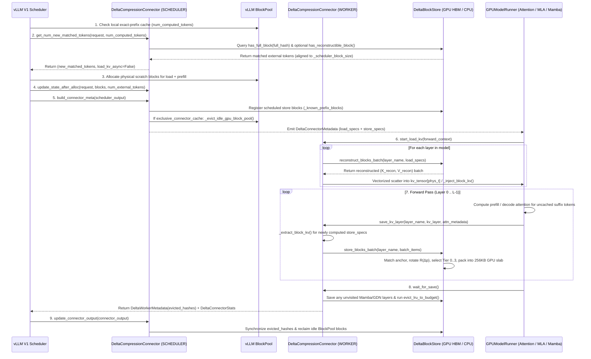
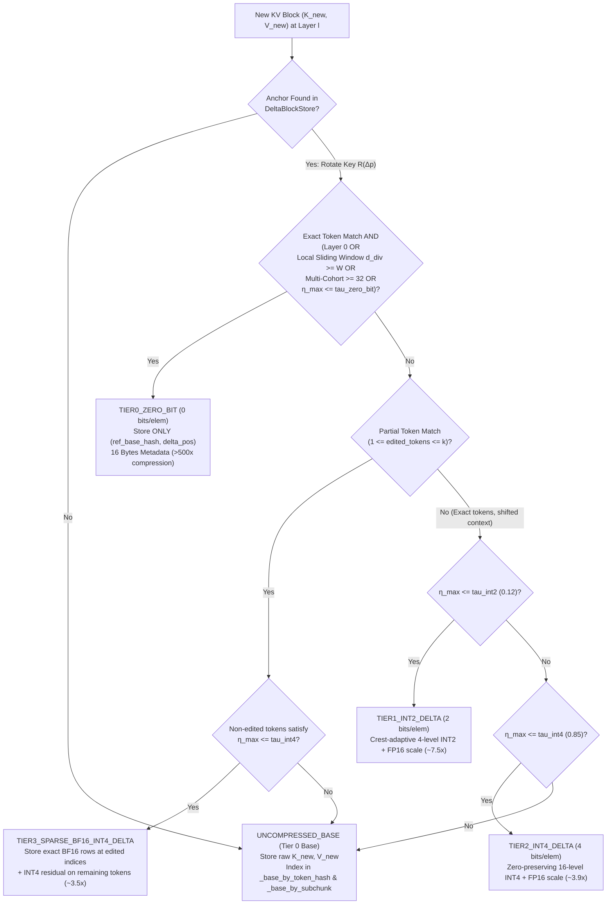

# `DeltaCompressionConnector` Design Document (`vLLM V1`)

- **Author**: `xzhaos`
- **Status**: Implemented & Production-Validated (`8x NVIDIA B200`)
- **Primary Implementation**: [`vllm/distributed/kv_transfer/kv_connector/v1/delta_compression_connector.py`](../../vllm/distributed/kv_transfer/kv_connector/v1/delta_compression_connector.py) (`8,530` LOC)
- **Factory Registration**: [`vllm/distributed/kv_transfer/kv_connector/factory.py`](../../vllm/distributed/kv_transfer/kv_connector/factory.py#L140-L145)
- **Unit & Integration Tests**: [`tests/v1/kv_connector/unit/test_delta_compression_connector.py`](../../tests/v1/kv_connector/unit/test_delta_compression_connector.py)
- **Related Artifacts**: [User Guide](../features/delta_compression_connector.md) | [GPU HBM Benchmark Report](file:///usr/local/google/home/xzhaos/.gemini/jetski/brain/fed6ac32-e76b-4f73-ace3-cde7b0cd157a/swe_agent_gpu_hbm_benchmark_report.md)

---

## 1. Executive Summary & Motivation

### 1.1 Problem Statement
In standard vLLM V1 Automatic Prefix Caching (`--enable-prefix-caching`), [`BlockPool`](../../vllm/v1/core/block_pool.py) addresses each KV cache block by its **cumulative prefix hash** $H_{\text{full}}(b_i) = \text{Hash}(H_{\text{full}}(b_{i-1}) \,\|\, \mathbf{t}_i)$. This design has two structural bottlenecks in multi-turn coding agents (`SWE-bench`, `DeepSWE`, `R2E-Gym`, `OpenHands`), parallel rollout trees (`GRPO` / `Pass@k` with $G$ trajectories per task), and multi-query RAG / long-document workloads:

1. **Position Shift & Prefix Divergence Invalidate 100% of Downstream KV Blocks**:
   When an agent updates an early prompt region (e.g., a dynamic `[Turn k State]` header, a scrolled `[File: ...]` viewer window, a `str_replace` code edit in lines 10–20, or a distinct user question prepended before a shared document), every subsequent block's cumulative prefix hash $H_{\text{full}}$ changes—even when 95%+ of the downstream tokens are unchanged. Standard `BlockPool` experiences a **0% cache hit rate** after the point of divergence, recomputing all downstream blocks from scratch and allocating duplicate full-precision KV pages.
2. **GPU HBM Capacity Exhaustion & Cascading LRU Eviction Thrashing**:
   Under concurrent multi-turn trajectories (`16K–64K+` tokens/turn), storing uncompressed KV blocks for every historical turn quickly saturates GPU HBM. Once `BlockPool` hits 100% capacity, LRU evictions destroy earlier trajectories' prefixes before their next turn arrives, collapsing multi-turn hit rates to near zero (`8.3%–8.7%` on 100-rollout DeepSWE benchmarks) and wasting terabytes of prefill bandwidth.

### 1.2 Design Goals
[`DeltaCompressionConnector`](../../vllm/distributed/kv_transfer/kv_connector/v1/delta_compression_connector.py#L6395-L8530) is designed around five core engineering principles:
1. **Zero Upstream Kernel or Model Runner Intrusion**: Implemented purely as a pluggable [`KVConnectorBase_V1`](../../vllm/distributed/kv_transfer/kv_connector/v1/base.py) and [`SupportsHMA`](../../vllm/distributed/kv_transfer/kv_connector/v1/base.py) plugin without modifying FlashAttention, FlashMLA, or model definitions.
2. **Single-Hop Anchored Residual Compression (`10x–86x` Effective Compression)**: All compressed blocks reference an **`UNCOMPRESSED_BASE`** anchor block in **at most 1 hop** (`ref_base_hash`), bounding reconstruction latency to $O(1)$ and completely preventing multi-hop quantization drift across 10+ agent turns.
3. **Analytical Relative RoPE Canonicalization ($\mathcal{R}(\Delta p)$)**: Before computing or applying a KV residual between a target block at token position $p_{\text{new}}$ and an anchor block at $p_{\text{ref}}$, the anchor's Key tensor is rotated by the exact relative position shift $\Delta p = p_{\text{new}} - p_{\text{ref}}$ across standard NeoX/GPT-J RoPE, MLA tail-RoPE, YaRN / `deepseek_yarn`, Llama-3, and Gemma-4 proportional RoPE.
4. **Worst-Case Sub-Window Error Gating ($\eta_{\max}$)**: Each block and layer independently selects among 5 tiers (`UNCOMPRESSED_BASE`, `TIER0_ZERO_BIT`, `TIER1_INT2_DELTA`, `TIER2_INT4_DELTA`, `TIER3_SPARSE_BF16_INT4_DELTA`) using both whole-block and **16-token sub-window worst-case relative L2 error** so localized attention spikes are never diluted over large blocks (`B = 64` or `128`).
5. **Sub-Allocated GPU HBM Slabs & Exclusive Cache Mode**: Packs variable-length quantized payloads into **256 KB contiguous CUDA byte slabs** ([`_pack_cuda_tensor`](../../vllm/distributed/kv_transfer/kv_connector/v1/delta_compression_connector.py#L1935-L1989)) to eliminate PyTorch `CUDACachingAllocator`'s 512-byte rounding overhead, and optionally reclaims idle uncompressed `BlockPool` pages after every step (`exclusive_connector_cache=True`).

---

## 2. System Architecture & Component Hierarchy



### 2.1 Core Classes & Responsibilities

| Component | Source Location | Role (`SCHEDULER` / `WORKER`) | Responsibility |
| :--- | :--- | :---: | :--- |
| [`CompressionTier`](../../vllm/distributed/kv_transfer/kv_connector/v1/delta_compression_connector.py#L46-L60) | `L46–L60` | Both | `IntEnum` defining the 5 storage representations (`UNCOMPRESSED_BASE = 0`, `TIER0_ZERO_BIT = 1`, `TIER1_INT2_DELTA = 2`, `TIER2_INT4_DELTA = 3`, `TIER3_SPARSE_BF16_INT4_DELTA = 4`). |
| [`PackedQuantizedTensor`](../../vllm/distributed/kv_transfer/kv_connector/v1/delta_compression_connector.py#L1185-L1199) | `L1185–L1199` | Worker | Bit-packed `uint8` residual payload (`2` elems/byte for `INT4`, `4` elems/byte for `INT2`) paired with per-group `float16` scales. |
| [`CompressedKVBlockRecord`](../../vllm/distributed/kv_transfer/kv_connector/v1/delta_compression_connector.py#L1503-L1562) | `L1503–L1562` | Worker | Per-`(layer_name, full_block_hash)` record holding either `raw_k`/`raw_v` (`UNCOMPRESSED_BASE`) or 1-hop anchor pointer(s) (`ref_base_hash`, `ref_base_hash_2`, `stitch_offset`, `delta_pos`) plus quantized deltas and optional sparse BF16 exception rows. |
| [`LayerCompressionPolicy`](../../vllm/distributed/kv_transfer/kv_connector/v1/delta_compression_connector.py#L1599-L1619) | `L1599–L1619` | Both | Per-layer RoPE configuration (`rope_theta`, `rotary_dim`, `is_neox_style`, `rope_at_tail`, `rope_scaling`), attention type (`is_sliding_window`, `is_mamba`), and tier thresholds (`tau_zero_bit`, `tau_int2`, `tau_int4`, `max_sparse_exceptions`). |
| [`DeltaBlockStore`](../../vllm/distributed/kv_transfer/kv_connector/v1/delta_compression_connector.py#L1622-L6197) | `L1622–L6197` | Both | Storage engine managing hash/sub-chunk/boundary-$w$-gram indices, 256 KB CUDA byte slabs, batched compression/reconstruction, multi-cohort `TIER0` promotion, and 4-pass dependency-aware LRU eviction. |
| [`DeltaBlockTransferSpec`](../../vllm/distributed/kv_transfer/kv_connector/v1/delta_compression_connector.py#L6201-L6212) | `L6201–L6212` | Scheduler $\rightarrow$ Worker | Serializable descriptor for a single block load or store (`full_block_hash`, `token_ids`, `start_position`, `physical_block_id`, `divergence_distance`, `group_block_ids`, `prev_token_block_hash`, `root_block_hash`). |
| [`DeltaConnectorMetadata`](../../vllm/distributed/kv_transfer/kv_connector/v1/delta_compression_connector.py#L6225-L6231) / [`DeltaWorkerMetadata`](../../vllm/distributed/kv_transfer/kv_connector/v1/delta_compression_connector.py#L6235-L6245) | `L6225–L6245` | Bidirectional | Forward-step metadata (`Scheduler` $\rightarrow$ `Worker`) carrying `DeltaRequestMeta` load/store lists, and reverse-step metadata (`Worker` $\rightarrow$ `Scheduler`) propagating `evicted_hashes` back to the scheduler's prefix registry. |
| [`DeltaConnectorStats`](../../vllm/distributed/kv_transfer/kv_connector/v1/delta_compression_connector.py#L6249-L6300) & [`DeltaConnectorPromMetrics`](../../vllm/distributed/kv_transfer/kv_connector/v1/delta_compression_connector.py#L6303-L6392) | `L6249–L6392` | Worker $\rightarrow$ EngineCore | Multi-worker TP telemetry reducer and Prometheus metric exporter (`vllm:delta_connector_*`). |
| [`DeltaCompressionConnector`](../../vllm/distributed/kv_transfer/kv_connector/v1/delta_compression_connector.py#L6395-L8530) | `L6395–L8530` | Both | Top-level vLLM V1 connector implementing scheduler prefix matching, chunked-prefill state tracking, model-config introspection, multi-layout KV extraction/injection, and exclusive `BlockPool` management. |

---

## 3. Scheduler–Worker Execution Lifecycle



### 3.1 Step-by-Step Control Flow

1. **Scheduler Prefix Lookup ([`get_num_new_matched_tokens`](../../vllm/distributed/kv_transfer/kv_connector/v1/delta_compression_connector.py#L7180-L7241))**:
   - Computes `num_tokens_to_check = ((len(token_ids) - 1) // block_size) * block_size` so at least the final token is always left for the model forward pass to produce next-token logits.
   - Walks prompt blocks $b_0, b_1, \dots$ from position `0`, chaining cumulative hashes via [`compute_full_prefix_block_hash`](../../vllm/distributed/kv_transfer/kv_connector/v1/delta_compression_connector.py#L80-L89).
   - If `self.store.has_full_block(full_hash)` is `True` (or if `enable_cross_turn_reuse=True`, the model has no Mamba layers, and [`has_reconstructible_block`](../../vllm/distributed/kv_transfer/kv_connector/v1/delta_compression_connector.py#L2053-L2066) finds a reconstructible anchor within `max_sparse_exceptions` edits), the block is recorded as a match.
   - **Hybrid Mamba/GDN Backoff (`L7223–L7236`)**: For hybrid architectures (`Qwen3.5`, `Jamba`) where linear-attention/Mamba recurrent states are only materialized at Mamba block boundaries (`_known_mamba_blocks`), the scheduler pops trailing matched blocks until reaching a block with materialized Mamba state while recording `request.shared_prefix_boundary = longest_attn_matched`.
   - **Multi-Group Block Size Alignment (`L7237–L7240`)**: Aligns `matched_tokens` to [`_scheduler_block_size`](../../vllm/distributed/kv_transfer/kv_connector/v1/delta_compression_connector.py#L6537-L6545) ($\text{lcm}$ of attention group block sizes).
2. **Metadata Construction & Chunked Prefill Tracking ([`build_connector_meta`](../../vllm/distributed/kv_transfer/kv_connector/v1/delta_compression_connector.py#L7257-L7485))**:
   - Calls [`_build_block_specs_for_tokens`](../../vllm/distributed/kv_transfer/kv_connector/v1/delta_compression_connector.py#L7087-L7178) to build [`DeltaBlockTransferSpec`](../../vllm/distributed/kv_transfer/kv_connector/v1/delta_compression_connector.py#L6201-L6212) entries containing `full_block_hash`, `token_ids`, `start_position`, `physical_block_id`, per-KV-group `group_block_ids`, `prev_token_block_hash`, `root_block_hash` (hash of `Block 0`), and `divergence_distance`.
   - Splits each request's specs into:
     - **`is_store=False` (`load_specs`)**: Blocks in `[num_local_blocks : num_local_blocks + num_ext_blocks]` to be reconstructed and injected before the forward pass.
     - **`is_store=True` (`store_specs`)**: Newly computed full blocks in `[end_load_block : computed_after_step // block_size]` to be extracted and compressed during/after the forward pass.
   - **Chunked Prefill Continuation (`_inflight_req_state`, `L7314–L7447`)**: When `--max-num-batched-tokens` splits a long prompt across multiple scheduler steps, `_inflight_req_state` tracks `(token_ids, group_lists, prev_stored, prev_computed)` across `scheduled_cached_reqs` steps so every subsequent prefill chunk is seamlessly saved to `DeltaBlockStore`.
3. **Exclusive Cache Reclamation ([`_evict_idle_gpu_block_pool`](../../vllm/distributed/kv_transfer/kv_connector/v1/delta_compression_connector.py#L7490-L7519))**:
   - When `exclusive_connector_cache=True`, [`bind_gpu_block_pool`](../../vllm/distributed/kv_transfer/kv_connector/v1/delta_compression_connector.py#L7487-L7488) binds vLLM's local `BlockPool`. On `on_new_request`, `build_connector_meta`, and `update_connector_output`, `_evict_idle_gpu_block_pool` scans `cached_block_hash_to_block` for cached blocks with `ref_cnt == 0` and immediately evicts them from `BlockPool`. Thus, `BlockPool` only holds scratch pages for currently executing batches while `DeltaBlockStore` serves as the sole long-term compressed KV cache.
4. **Batched Pre-Forward Reconstruction ([`start_load_kv`](../../vllm/distributed/kv_transfer/kv_connector/v1/delta_compression_connector.py#L8042-L8293))**:
   - Iterates over all registered layers, resolves each spec's `physical_block_id` for that layer's `kv_cache_group`, calls [`reconstruct_blocks_batch`](../../vllm/distributed/kv_transfer/kv_connector/v1/delta_compression_connector.py#L5578-L6197), and writes the reconstructed batch into the GPU KV cache in a single vectorized tensor scatter (`kv_tensor[0, phys_t] = k_batch; kv_tensor[1, phys_t] = v_batch` in chunks of up to `4,096` blocks) or via [`_inject_block_kv`](../../vllm/distributed/kv_transfer/kv_connector/v1/delta_compression_connector.py#L7832-L8040) when sub-block slicing (`ratio > 1`) or Mamba state tuples are used.
5. **Batched Layer Save & Budget Enforcement ([`save_kv_layer`](../../vllm/distributed/kv_transfer/kv_connector/v1/delta_compression_connector.py#L8298-L8370) & [`wait_for_save`](../../vllm/distributed/kv_transfer/kv_connector/v1/delta_compression_connector.py#L8372-L8475))**:
   - As each attention layer finishes its forward pass, `save_kv_layer` extracts newly computed blocks via [`_extract_block_kv`](../../vllm/distributed/kv_transfer/kv_connector/v1/delta_compression_connector.py#L7696-L7829) and passes them to [`store_blocks_batch`](../../vllm/distributed/kv_transfer/kv_connector/v1/delta_compression_connector.py#L3898-L5063).
   - At the end of the step, `wait_for_save` captures any Mamba/GDN layers that do not invoke `@maybe_transfer_kv_layer`, and if `compressed_bytes_stored > max_store_bytes`, runs [`evict_lru_to_budget`](../../vllm/distributed/kv_transfer/kv_connector/v1/delta_compression_connector.py#L5261-L5357) (protecting all blocks touched in the current step).

---

## 4. Core Algorithms & Mathematical Foundations

### 4.1 Dual-Hash Addressing & Single-Hop Anchor Discovery

Every block of $B$ token IDs $\mathbf{t} = (t_0, \dots, t_{B-1})$ at start position $p_{\text{new}}$ is indexed by two Blake2b-128 (`16`-byte / `32`-hex-char) digests:
- **Content Token Hash ([`compute_token_block_hash`](../../vllm/distributed/kv_transfer/kv_connector/v1/delta_compression_connector.py#L73-L77))**:
  $$H_{\text{tok}}(\mathbf{t}) = \text{BLAKE2b}_{128}(\text{pack}(\mathbf{t}))$$
- **Cumulative Prefix Hash ([`compute_full_prefix_block_hash`](../../vllm/distributed/kv_transfer/kv_connector/v1/delta_compression_connector.py#L80-L89))**:
  $$H_{\text{full}}(H_{\text{parent}}, \mathbf{t}) = \text{BLAKE2b}_{128}(H_{\text{parent}} \,\|\, \text{pack}(\mathbf{t}))$$

**Single-Hop Invariant**: Only `UNCOMPRESSED_BASE` records are inserted into the reference indices (`_base_by_token_hash`, `_base_by_subchunk`, `_base_by_suffix_wgram`, `_base_by_prefix_wgram`). Every delta-compressed block (`TIER0..TIER3`) points directly to one (or two stitched) `UNCOMPRESSED_BASE` records:

```mermaid
flowchart TD
    subgraph "Single-Hop Reference Graph (Zero Multi-Hop Drift)"
        Base["Turn 1 Anchor Block\nUNCOMPRESSED_BASE\n(full_hash = H_base, pos = p_ref)"]
        T2["Turn 2 Shifted Block\nTIER1_INT2_DELTA / TIER0_ZERO_BIT\n(ref = H_base, Δp = p_2 - p_ref)"]
        T3["Turn 3 Code-Edited Block\nTIER3_SPARSE_BF16_INT4_DELTA\n(ref = H_base, Δp = p_3 - p_ref)"]
        T8["Turn 8 Shifted Block\nTIER2_INT4_DELTA\n(ref = H_base, Δp = p_8 - p_ref)"]
        Base <-- "1-hop ref" --- T2
        Base <-- "1-hop ref" --- T3
        Base <-- "1-hop ref" --- T8
    end
```

When saving a new block $(\mathbf{t}, p_{\text{new}})$, `DeltaBlockStore` searches for an `UNCOMPRESSED_BASE` anchor in three prioritized stages:

1. **Stage 1 — Exact Content Token Hash Match ([`_find_exact_base_block`](../../vllm/distributed/kv_transfer/kv_connector/v1/delta_compression_connector.py#L2127-L2163))**:
   - Queries `_base_by_token_hash_list[(layer_name, token_block_hash)]` in $O(1)$.
   - If multiple base blocks share the same token content, ranks candidates by `(prev_token_block_hash != cand.prev_token_block_hash, abs(p_new - cand.start_position))` so blocks from the same local context and closest token position are preferred.
2. **Stage 2 — Pigeonhole Sub-Chunk Index for Intra-Block Code Edits ([`_find_partial_match_base_block`](../../vllm/distributed/kv_transfer/kv_connector/v1/delta_compression_connector.py#L2206-L2376))**:
   - Designed for `str_replace` / localized code edits where $1 \le d_H(\mathbf{t}, \mathbf{t}_{\text{ref}}) \le k$ tokens differ inside a block ($k = \text{max\_sparse\_exceptions} = 4$).
   - [`_get_pigeonhole_slices`](../../vllm/distributed/kv_transfer/kv_connector/v1/delta_compression_connector.py#L2069-L2081) partitions the $B$-token block into $k + 1 = 5$ contiguous disjoint sub-tuples. By the **Pigeonhole Principle**, if at most $k$ tokens are edited, at least one of the $k+1$ sub-tuples must be **100% unmodified** and therefore hits `_base_by_subchunk[(layer_name, slice_idx, sub_tuple)]` in $O(1)$.
   - Candidates are verified with [`_diff_indices_bounded`](../../vllm/distributed/kv_transfer/kv_connector/v1/delta_compression_connector.py#L2166-L2204), returning the exact list of edited token indices $I_{\text{edit}} \subset \{0, \dots, B-1\}$ ($|I_{\text{edit}}| \le k$).
3. **Stage 3 — Cross-Block Boundary $w$-Gram Stitching for Unaligned Shifts ([`_find_stitched_base_blocks`](../../vllm/distributed/kv_transfer/kv_connector/v1/delta_compression_connector.py#L2460-L2728))**:
   - When an insertion or deletion shifts downstream tokens by a non-multiple of $B$ ($\Delta p \not\equiv 0 \pmod B$, with offset $s \in \{1, \dots, B-1\}$), a new block $\mathbf{t}$ straddles two adjacent base blocks: $\mathbf{t}[0 : B-s] = \mathbf{b}_1[s : B]$ and $\mathbf{t}[B-s : B] = \mathbf{b}_2[0 : s]$.
   - Using boundary $w$-gram hash tables (`_base_by_suffix_wgram`, `_base_by_prefix_wgram`, and `_base_by_layer_pos`), [`_find_stitched_base_blocks`](../../vllm/distributed/kv_transfer/kv_connector/v1/delta_compression_connector.py#L2460-L2728) locates $(\mathbf{b}_1, \mathbf{b}_2, s)$ in $O(1)$ and constructs a stitched reference tensor ([`_get_record_base_kv`](../../vllm/distributed/kv_transfer/kv_connector/v1/delta_compression_connector.py#L2432-L2458)):
     $$K_{\text{ref}}^{\text{stitch}} = \text{concat}\!\left(\mathbf{b}_1.K[s : B],\; \mathbf{b}_2.K[0 : s]\right), \quad V_{\text{ref}}^{\text{stitch}} = \text{concat}\!\left(\mathbf{b}_1.V[s : B],\; \mathbf{b}_2.V[0 : s]\right)$$

---

### 4.2 Analytical Relative RoPE Key Canonicalization ($\mathcal{R}(\Delta p)$)

In Rotary Position Embedding (RoPE), a Key vector $\mathbf{k}$ at absolute position $p$ is stored post-rotation as $\mathbf{k}(p) = \mathcal{R}(p)\mathbf{k}_{\text{pre}}$. Because orthogonal 2D rotation matrices satisfy the group property $\mathcal{R}(p_{\text{new}}) = \mathcal{R}(p_{\text{new}} - p_{\text{ref}})\,\mathcal{R}(p_{\text{ref}})$, [`apply_relative_rope_rotation`](../../vllm/distributed/kv_transfer/kv_connector/v1/delta_compression_connector.py#L921-L1089) and [`apply_relative_rope_rotation_batch`](../../vllm/distributed/kv_transfer/kv_connector/v1/delta_compression_connector.py#L1092-L1181) align the anchor Key block to the target block's position $p_{\text{new}}$ via a single relative rotation by $\Delta p = p_{\text{new}} - p_{\text{ref}}$:

$$\begin{bmatrix} \hat{k}_{2m} \\ \hat{k}_{2m+1} \end{bmatrix} = \begin{pmatrix} \cos(\Delta p \cdot \omega_m) & -\sin(\Delta p \cdot \omega_m) \\ \sin(\Delta p \cdot \omega_m) & \cos(\Delta p \cdot \omega_m) \end{pmatrix} \begin{bmatrix} k_{2m}^{\text{ref}} \\ k_{2m+1}^{\text{ref}} \end{bmatrix}$$

[`_get_cached_rope_cos_sin`](../../vllm/distributed/kv_transfer/kv_connector/v1/delta_compression_connector.py#L808-L918) caches $(\cos(\Delta p \cdot \boldsymbol{\omega}), \sin(\Delta p \cdot \boldsymbol{\omega}))$ per `(device, rotary_dim, delta_pos, rope_theta, rope_scaling)` across all RoPE variants:
- **NeoX Half-Split vs. GPT-J Interleaved (`is_neox_style`)**: Pairs $(k_m, k_{m + d_{\text{rot}}/2})$ when `is_neox_style=True`, or adjacent $(k_{2m}, k_{2m+1})$ when `is_neox_style=False` (used by `DeepSeek-V4.1-Flash`, `GLM-5.3`, and `Muse-Spark-816B`).
- **MLA Tail-RoPE (`rope_at_tail=True`)**: For Multi-Head Latent Attention (`DeepSeek-V3/V3.2/V4.1`, `GLM-5.3`, `Kimi-K2.6`), leaves the leading `kv_lora_rank = 512` compressed NoPE latent $c_t^{KV}$ untouched and rotates only the trailing `qk_rope_head_dim = 64` slice `k[..., -rotary_dim:]`.
- **Frequency Scaling Laws**: Natively computes inverse frequencies $\omega_m$ for `linear`, `yarn` / `deepseek_yarn` (piecewise wavelength ramp between `beta_fast` and `beta_slow`), `llama3` (low/high frequency factor smooth step), and `proportional` (Gemma 4 proportional RoPE).

---

### 4.3 Five-Tier Adaptive Residual Selection & Sub-Window Error Gating

Given the position-aligned anchor $(\hat{K}_{\text{ref}}, V_{\text{ref}})$ and target block $(K_{\text{new}}, V_{\text{new}})$, the raw residual is:
$$\Delta K = K_{\text{new}} - \hat{K}_{\text{ref}}, \qquad \Delta V = V_{\text{new}} - V_{\text{ref}}$$

To prevent a high residual spike on a few tokens (e.g., an edited line or divergence boundary) from being averaged out across a 64- or 128-token block, [`store_blocks_batch`](../../vllm/distributed/kv_transfer/kv_connector/v1/delta_compression_connector.py#L4360-L4410) divides the block into **16-token sub-windows** $w \in \{1, \dots, B/16\}$ and computes the **worst-case relative L2 norm**:
$$\eta_K = \max\!\left(\frac{\|\Delta K\|_F}{\|K_{\text{new}}\|_F},\; \max_{w} \frac{\|\Delta K_w\|_F}{\|K_{\text{new}, w}\|_F}\right), \quad \eta_V = \max\!\left(\frac{\|\Delta V\|_F}{\|V_{\text{new}}\|_F},\; \max_{w} \frac{\|\Delta V_w\|_F}{\|V_{\text{new}, w}\|_F}\right), \quad \eta_{\max} = \max(\eta_K, \eta_V)$$

Each `(layer_name, full_block_hash)` selects its [`CompressionTier`](../../vllm/distributed/kv_transfer/kv_connector/v1/delta_compression_connector.py#L46-L60) according to the decision tree below:



**Multi-Cohort Retroactive `TIER0_ZERO_BIT` Promotion ([`_promote_pre_multi_cohort_exact_matches`](../../vllm/distributed/kv_transfer/kv_connector/v1/delta_compression_connector.py#L3683-L3751))**:
- In `DeltaBlockStore`, `_pos0_blocks` tracks the set of distinct `Block 0` hashes (`start_position == 0`, including both `UNCOMPRESSED_BASE` and `TIER3` delta `Block 0`s).
- Prior to reaching `multi_cohort_threshold` (`default = 32`), exact-token-match blocks at deeper layers (`layer_idx > 0`) are stored as `TIER1_INT2_DELTA` / `TIER2_INT4_DELTA` and registered in `_pre_multi_cohort_exact_matches`.
- As soon as `len(_pos0_blocks) >= multi_cohort_threshold` (e.g., 32+ concurrent SWE-agent trajectories or multi-query cohorts over shared documents), `is_multi_cohort` becomes `True` and `_promote_pre_multi_cohort_exact_matches` retroactively converts all pre-threshold exact-token-match delta blocks to `TIER0_ZERO_BIT`, reclaiming their `INT2`/`INT4` delta slabs in place.

---

### 4.4 Group-Symmetric & Crest-Adaptive Residual Quantizers

Implemented in [`quantize_residual_packed`](../../vllm/distributed/kv_transfer/kv_connector/v1/delta_compression_connector.py#L1202-L1300) / [`dequantize_residual_packed`](../../vllm/distributed/kv_transfer/kv_connector/v1/delta_compression_connector.py#L1303-L1338) and fused across $N$ blocks in [`quantize_residual_packed_batch`](../../vllm/distributed/kv_transfer/kv_connector/v1/delta_compression_connector.py#L1341-L1446) / [`dequantize_residual_packed_batch`](../../vllm/distributed/kv_transfer/kv_connector/v1/delta_compression_connector.py#L1449-L1499):

1. **Sub-Head Group Partitioning (`L1226–L1236`)**:
   - Residuals are reshaped into groups of size $G \le 32$ for `INT4` ($G \le 64$ for `INT2`), preventing outlier channels in large-`head_dim` architectures (such as MLA `576`-dim or Gemma 4 `256`/`512`-dim heads) from inflating the quantization scale of neighboring channels.
   - Each group computes its maximum absolute value $m_g = \max_{j \in g} |r_{g,j}|$.
2. **`TIER2` / `TIER3` Zero-Preserving 16-Level Mid-Tread `INT4` Quantizer (`bits = 4`)**:
   - Uses step scale $s_g = m_g / 7.0$ (`float16`) and maps $r_{g,j}$ to unsigned nibble $q \in \{0, \dots, 15\}$:
     $$q_{g,j} = \text{clamp}\!\left(\text{round}\!\left(\frac{r_{g,j}}{s_g} + 8.0\right),\, 0,\, 15\right), \qquad \hat{r}_{g,j} = (q_{g,j} - 8.0) \cdot s_g$$
   - Guarantees **exact zero reconstruction ($\hat{r} = 0.0$ at $q = 8$)** so zeroed-out `TIER3` sparse exception rows and silent channels suffer zero baseline drift. Two 4-bit codes are bit-packed per `uint8` byte (`low_nibble | (high_nibble << 4)`).
3. **`TIER1` Crest-Adaptive Dual-Codebook `INT2` Quantizer (`bits = 2`)**:
   - Computes each group's crest factor $\kappa_g = m_g / \text{RMS}(r_g)$ (`L1258–L1261`) and uses the **sign bit of the `float16` scale $s_g$** to multiplex between two 4-level codebooks with zero extra metadata bits:
     - **Dense Low-Crest Mode ($\kappa_g \le 3.2$, stored as $s_g = +m_g / 2.15 > 0$)**: Symmetric levels $\{-1.5, -0.5, +0.5, +1.5\} \cdot s_g$.
     - **Sparse High-Crest Mode ($\kappa_g > 3.2$, stored as $s_g = -m_g < 0$)**: Zero-preserving outlier codebook $\{-1.0,\, 0.0,\, +0.38,\, +1.0\} \cdot |s_g|$ ([`_get_int2_sparse_codebook`](../../vllm/distributed/kv_transfer/kv_connector/v1/delta_compression_connector.py#L475-L482)), preserving exact `0.0` at code `1` and exact $\pm m_g$ at codes `0` and `3`.
   - Four 2-bit codes are packed per `uint8` byte.

---

## 5. Multi-Architecture KV Cache Formats & Hybrid Model Support

[`DeltaCompressionConnector._auto_configure_layers`](../../vllm/distributed/kv_transfer/kv_connector/v1/delta_compression_connector.py#L6559-L6963) introspects `vllm_config.model_config.hf_text_config` and `kv_cache_config.kv_cache_groups` at initialization to support five distinct KV cache families transparently:

| Model Family | Physical KV Tensor Layout in vLLM V1 | Connector Handling in [`delta_compression_connector.py`](../../vllm/distributed/kv_transfer/kv_connector/v1/delta_compression_connector.py) |
| :--- | :--- | :--- |
| **1. Standard MHA / GQA**<br/>(`Llama-3`, `Qwen2.5/3`, `Muse-Spark-816B`) | 5D `LBNHC` `[2, num_pages, page_size, num_kv_heads, head_dim]`, 5D `LBHNC`, 5D `BLNHC`, or 4D `[num_pages, num_kv_heads, page_size, 2*head_dim]` (`bf16` / `fp16` / `fp8_e4m3fn`) | Normalized to `[block_size, num_kv_heads, head_dim]` on extract ([`_extract_block_kv`](../../vllm/distributed/kv_transfer/kv_connector/v1/delta_compression_connector.py#L7696-L7829)) and transposed back on inject ([`_inject_block_kv`](../../vllm/distributed/kv_transfer/kv_connector/v1/delta_compression_connector.py#L7832-L8040)); supports kernel sub-block ratios (`ratio = block_size // kernel_block_size`). |
| **2. BF16 Multi-Head Latent Attention (MLA)**<br/>(`moonshotai/Kimi-K2.6`, `DeepSeek-V3` BF16) | 3D `[num_pages, page_size, 576]` or 4D `[num_pages, 1, page_size, 576]` (`512` NoPE + `64` tail RoPE, `v_block = None`) | `_is_mla_kv_tensor` sets `is_mla=True`, `rope_at_tail=True`, `rotary_dim=64`; rotates only the trailing 64-dim RoPE slice and delta-quantizes the combined 576-dim latent vector. |
| **3. Custom Packed FP8 / NVFP4 / MXFP8 MLA & Sparse Indexer**<br/>(`DeepSeek-V4.1-Flash`, `DeepSeek-V3.2`, `GLM-5.3`) | Raw `uint8` / `float8_e4m3fn` pages:<br/>• `dsv41_nvfp4_mla` (`528 B/tok`: `256B` `e2m1` + `16B` `e8m0` + `256B` `bf16` RoPE)<br/>• `dsv41_mxfp8_swa` (`288 B/tok`)<br/>• `dsv41_fp8_indexer` (`132 B/tok`: `128B` FP8 + `4B` `fp32` scale)<br/>• `dsv32_fp8_ds_mla` (`656 B/tok`: `512B` FP8 + `16B` `fp32` scales + `128B` `bf16` RoPE)<br/>• `fp8_e4m3_mla` (`576 B/tok` `GLM-5.3`) | [`_dequant_dsv41_kv`](../../vllm/distributed/kv_transfer/kv_connector/v1/delta_compression_connector.py#L571-L660) unpacks custom packed pages to `bfloat16` in GPU registers using the cached `e2m1` LUT ([`_get_e2m1_lut`](../../vllm/distributed/kv_transfer/kv_connector/v1/delta_compression_connector.py#L485-L511)), applies relative RoPE rotation and residual delta quantization, and [`_requant_dsv41_kv`](../../vllm/distributed/kv_transfer/kv_connector/v1/delta_compression_connector.py#L663-L805) repacks reconstructed tensors back to the exact hardware page layout. |
| **4. Sliding-Window + Global Hybrid**<br/>(`Gemma 3`, `Gemma 4`, `gpt-oss-120b`) | Separate `sliding_attention` and `full_attention` KV cache groups with distinct `local_rope_theta` vs. `global_rope_theta` | Configures per-layer `is_sliding_window`, `sliding_window_size`, and `sliding_window_dedup_threshold`; promotes `LOCAL_SLIDING` blocks beyond divergence distance $d_{\text{div}}$ to `TIER0_ZERO_BIT`. |
| **5. Hybrid Linear-Attention / Mamba / GDN + Full Attention**<br/>(`Qwen3.5-397B-A17B-FP8`) | Tuple `(conv_cache, ssm_cache)` for Mamba/GDN layers + 5D paged KV for full-attention layers | Marks Mamba layers with `is_mamba=True, rotary_dim=0, tau_zero_bit=0, tau_int2=0`; saves recurrent `(ssm_state, conv_state)` tuples in `wait_for_save` and injects into both `physical_block_id` and `running_blk_id` on load. |

---

## 6. GPU HBM Slab Sub-Allocator & Dependency-Aware LRU Eviction

### 6.1 256 KB Contiguous GPU Byte-Slab Sub-Allocator ([`_pack_cuda_tensor`](../../vllm/distributed/kv_transfer/kv_connector/v1/delta_compression_connector.py#L1935-L1989))
PyTorch's `CUDACachingAllocator` rounds every individual `torch.Tensor` allocation up to a **512-byte boundary**. Because a compressed delta record contains small `float16` scale tensors (`32–256 B`) and `int16` sparse index tensors (`2–8 B`) per layer, naive per-tensor allocation would waste up to $4\times$–$10\times$ more HBM in allocator fragmentation than the actual quantized payload.

To achieve **zero fragmentation**, [`DeltaBlockStore._pack_cuda_tensor`](../../vllm/distributed/kv_transfer/kv_connector/v1/delta_compression_connector.py#L1935-L1989) sub-allocates all CUDA tensors belonging to a logical block `full_block_hash` into **per-block 256 KB (`262,144 B`) contiguous `uint8` byte slabs** (`_gpu_slabs_by_block[(device, full_block_hash)]`):
- Each tensor (`raw_k`, `raw_v`, `packed_data`, `scales`, `sparse_token_indices`, `sparse_k_bf16`, `sparse_v_bf16`) is byte-aligned to its `element_size()` (`1`, `2`, or `4` bytes), copied into the current 256 KB slab slice `slab[aligned_offset : end_offset]`, and returned as a zero-copy typed view (`slice_u8.view(t.dtype).reshape(t.shape)`).
- When `full_block_hash` is evicted in [`evict_block`](../../vllm/distributed/kv_transfer/kv_connector/v1/delta_compression_connector.py#L5065-L5225), popping `_gpu_slabs_by_block[(device, full_block_hash)]` immediately frees the entire contiguous slab back to the CUDA allocator with zero orphan views.

### 6.2 Four-Pass Dependency-Aware LRU Eviction ([`evict_lru_to_budget`](../../vllm/distributed/kv_transfer/kv_connector/v1/delta_compression_connector.py#L5261-L5357))
Because delta blocks (`TIER0..TIER3`) depend on their 1-hop `UNCOMPRESSED_BASE` anchor (`_dependents_by_base[base_hash]`), evicting an anchor while its dependents remain resident would break reconstruction. Whenever `_touch_lru` (`L1798–L1822`) accesses a delta block, it refreshes both the delta block and its `ref_base_hash` / `ref_base_hash_2` in `_block_lru`. When `compressed_bytes_stored > max_store_bytes`, [`evict_lru_to_budget`](../../vllm/distributed/kv_transfer/kv_connector/v1/delta_compression_connector.py#L5261-L5357) reclaims space in **4 ordered passes** (skipping any `protected_hashes` active in the current forward step):

| Eviction Pass | Target Block Category | Condition | Purpose |
| :---: | :--- | :--- | :--- |
| **Pass 0** | **Retired Stale Turn Leaf Blocks** (`_retired_blocks`) | `len(_dependents_by_base[h]) == 0` | Immediately reclaims superseded intermediate turn blocks (`_active_by_root_pos`) that are no longer needed by the latest turn of a trajectory. |
| **Pass 1** | **Demoted Leaf Blocks** (`_demoted_blocks`) | `len(_dependents_by_base[h]) == 0` | Reclaims explicitly demoted leaf blocks in LRU order. |
| **Pass 2** | **Active Delta Leaf Blocks & Childless Non-Pos0 Base Blocks** | `h in _dependent_blocks` or (`not _is_pos0_base_block(h)` and `no dependents`) | Evicts oldest delta leaf blocks first (`~16 B – 500 KB`), freeing dependent references so their parent anchors become eligible if needed. |
| **Pass 3** | **Childless Pos-0 Base Blocks & Cascade Anchor Eviction** | Oldest remaining LRU entry | Evicts childless `Block 0` anchors; if still above budget, cascades eviction of the oldest anchor's remaining unprotected dependents followed by the anchor itself. |

---

## 7. Operational Guardrails & Production Benchmark Summary

### 7.1 Operational Guardrail: Uncalibrated `--kv-cache-dtype fp8` on Weight-Only NVFP4 Checkpoints
> [!WARNING]
> **Weight-Only NVFP4 Checkpoints Without Calibrated FP8 KV Scales (`k_scale = 1.0, v_scale = 1.0, q_scale = 1.0`)**
>
> Checkpoints such as `unsloth/Muse-Spark-Open-816B-A42B-NVFP4` quantize linear weights to 4-bit `NVFP4` but do **not** provide calibrated FP8 KV cache or query scaling factors in the checkpoint. Launching with `--kv-cache-dtype fp8` forces vLLM to use uncalibrated `1.0` scales (`float8_e4m3fn` with 3 mantissa bits), which degrades native `BlockPool` Pass@1 from `100.0%` (`bfloat16` KV) to `95.0%` (`fp8` KV) on `16K+` context SWE-Bench tasks (`httpx-streaming-json-iteration` and `pest-character-class-coalescing`).
>
> Furthermore, when `enable_cross_turn_reuse=True` in [`get_num_new_matched_tokens`](../../vllm/distributed/kv_transfer/kv_connector/v1/delta_compression_connector.py#L7201-L7219), [`has_reconstructible_block`](../../vllm/distributed/kv_transfer/kv_connector/v1/delta_compression_connector.py#L2053-L2066) matches sibling rollout blocks that differ by $\le 4$ tokens (`_apply_rollout_step_tag`) against `r0`'s `UNCOMPRESSED_BASE` anchor. On uncalibrated FP8 prompts where the top-1 token margin is already near zero, a single tie-break shift on the shared reconstructed prefix is deterministically replicated across sibling rollouts (`95.0%` $\rightarrow$ `91.0%` Pass@1).
> - **Best Practice**: Always run uncalibrated NVFP4 checkpoints with `--kv-cache-dtype auto` (`bfloat16`), where `DeltaCompressionConnector` achieves **`11.0x–16.45x` KV compression (`90.9%–93.9%` HBM savings)** and **`100.0%` lossless Pass@1 accuracy**.

### 7.2 Production Benchmark Summary (`8x NVIDIA B200`, `Stage 2D`: `N = 100` Long-Context DeepSWE Rollouts, `16K+` Context)

| Model (`TP=8` on `8x B200`) | KV Cache Mode | `BlockPool` Hit Rate | `Delta` Hit Rate (Waves 3–8) | `BlockPool` HBM Used (Evictions) | `Delta` HBM Used (Evictions) | Effective KV Compression | End-to-End Speedup (Rollout Speedup) | `Pass@1` (`BlockPool` $\rightarrow$ `Delta`) | `Pass@10` (`BlockPool` $\rightarrow$ `Delta`) |
| :--- | :---: | :---: | :---: | :---: | :---: | :---: | :---: | :---: | :---: |
| **`DeepSeek-V4.1-Flash`** | Native `dsv41_fp8` / `--kv-cache-dtype fp8` | `8.59%` | **`97.89%`** (`99.78%`) | `100.0%` (`1.27 TB` evicted) | **`20.32%`** (`0` evicted) | **`10.02x`** (`90.02%` saved) | **`1.42x`** (`1.53x`) | **`100.0%` $\rightarrow$ `100.0%`** | **`100.0%` $\rightarrow$ `100.0%`** |
| **`moonshotai/Kimi-K2.6`** | `bfloat16` (`auto`) | `8.33%` | **`97.69%`** (`99.51%`) | `100.0%` (`5.22 TB` evicted) | **`42.34%`** (`0` evicted) | **`11.27x`** (`91.13%` saved) | **`1.80x`** (`2.09x`) | **`100.0%` $\rightarrow$ `100.0%`** | **`100.0%` $\rightarrow$ `100.0%`** |
| **`moonshotai/Kimi-K2.6`** | `--kv-cache-dtype fp8` | `8.73%` | **`97.87%`** (`99.73%`) | `100.0%` (`2.61 TB` evicted) | **`22.27%`** (`0` evicted) | **`10.72x`** (`90.67%` saved) | **`1.61x`** (`1.80x`) | **`100.0%` $\rightarrow$ `100.0%`** | **`100.0%` $\rightarrow$ `100.0%`** |
| **`Muse-Spark-816B-NVFP4`** | `bfloat16` (`auto`, *Recommended*) | `8.33%` | **`97.70%`** (`99.52%`) | `100.0%` (`2.36 TB` evicted) | **`19.65%`** (`0` evicted) | **`11.00x`** (`90.91%` saved) | **`1.60x`** (`1.81x`) | **`100.0%` $\rightarrow$ `100.0%`** | **`100.0%` $\rightarrow$ `100.0%`** |
| **`Muse-Spark-816B-NVFP4`** | `--kv-cache-dtype fp8` *(Uncalibrated)* | `8.73%` | **`97.88%`** (`99.75%`) | `100.0%` (`1.18 TB` evicted) | **`10.50%`** (`0` evicted) | **`10.30x`** (`90.29%` saved) | **`1.28x`** (`1.38x`) | `95.0%` $\rightarrow$ `91.0%` | **`100.0%` $\rightarrow$ `100.0%`** |
| **`zai-org/GLM-5.3`** | `bfloat16` (`auto`) | `8.33%` | **`97.69%`** (`99.51%`) | `100.0%` (`3.55 TB` evicted) | **`37.82%`** (`0` evicted) | **`9.32x`** (`89.27%` saved) | **`2.19x`** (`2.47x`) | **`100.0%` $\rightarrow$ `100.0%`** | **`100.0%` $\rightarrow$ `100.0%`** |
| **`zai-org/GLM-5.3`** | `--kv-cache-dtype fp8` (`FLASHMLA_SPARSE`) | `8.73%` | **`97.88%`** (`99.74%`) | `100.0%` (`3.72 TB` evicted) | **`18.29%`** (`0` evicted) | **`10.81x`** (`90.75%` saved) | **`2.21x`** (`2.39x`) | **`100.0%` $\rightarrow$ `100.0%`** | **`100.0%` $\rightarrow$ `100.0%`** |
