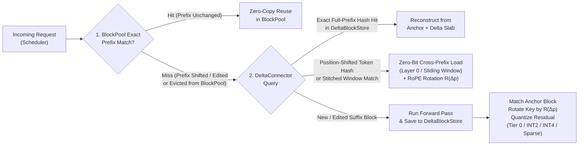

# `DeltaCompressionConnector` User Guide (`vLLM V1`)

[`DeltaCompressionConnector`](../../vllm/distributed/kv_transfer/kv_connector/v1/delta_compression_connector.py) is a drop-in **vLLM V1 `KVConnectorBase_V1`** plugin (registered in [`factory.py`](../../vllm/distributed/kv_transfer/kv_connector/factory.py#L140-L145)) that extends vLLM's exact-prefix caching (`BlockPool`) with **position-shifted cross-turn KV cache reuse** and **1-hop anchored residual delta compression** directly in **GPU HBM (`store_device="cuda"`)** or **CPU DRAM (`store_device="cpu"`)**.

---

## 1. Why Use `DeltaCompressionConnector`?

Standard vLLM prefix caching (`--enable-prefix-caching`) hashes each KV block by its **entire cumulative prefix chain** (`parent_hash + block_tokens`). In multi-turn agentic workloads (such as SWE-agent, DeepSWE, OpenHands, or RAG pipelines):
1. **Prefix Divergence Breaks Suffix Reuse**: Whenever an earlier block changes (e.g., an updated `[Turn k Action]` header, a prepended system message, or a `str_replace` edit in lines 10–20 of an open file), every subsequent block's cumulative hash changes — forcing vLLM to **recompute 100% of downstream blocks from scratch** and store duplicate full-precision copies in GPU HBM.
2. **LRU Eviction Thrashing Under Concurrent Sessions**: Because each turn allocates new uncompressed KV blocks (`5–10+` blocks/turn), concurrent agent trajectories rapidly exhaust the GPU HBM KV pool and trigger cascading LRU evictions.

`DeltaCompressionConnector` solves both problems without modifying upstream `vLLM` model runners or attention kernels:
- **Position-Independent Reference Matching + Relative RoPE Key Rotation ($\mathcal{R}(\Delta p)$)**: Matches incoming or newly computed blocks against previously stored anchor blocks by content hash (`token_block_hash`), two-block sliding window stitching (`_find_stitched_base_blocks`), or intra-block sub-chunk pigeonhole matching ($\le k$ token edits), and analytically rotates the reference Key tensor by the position shift $\Delta p = p_{\text{new}} - p_{\text{ref}}$ before computing or reconstructing the residual.
- **1-Hop Anchored Multi-Tier Residual Compression (`16x–18x` Effective Multi-Turn KV Compression)**: Stores Turn 1 as an uncompressed anchor (`Tier 0 Base`) and compresses follow-up turns into tightly packed 256 KB CUDA byte slabs (`Tier 0 Zero-Bit`, `Tier 1 INT2`, `Tier 2 INT4`, and `Tier 3 Sparse BF16 + INT4`), keeping **`3.5x–4.4x` more concurrent agent trajectories resident** in the same GPU HBM budget.

---

## 2. Quickstart

### 2.1 `vllm serve` CLI (Recommended GPU HBM Exclusive Cache Mode)

Launch `vllm serve` with `--enable-prefix-caching` and pass `--kv-transfer-config` with `"kv_connector": "DeltaCompressionConnector"`:

```bash
vllm serve deepseek-ai/DeepSeek-V4.1-Flash \
  --tensor-parallel-size 8 \
  --trust-remote-code \
  --enable-prefix-caching \
  --kv-cache-metrics \
  --kv-cache-metrics-sample 1.0 \
  --kv-transfer-config '{
    "kv_connector": "DeltaCompressionConnector",
    "kv_role": "kv_both",
    "kv_connector_extra_config": {
      "store_device": "cuda",
      "max_hbm_mb": 1435.5,
      "exclusive_connector_cache": true
    }
  }'
```

> [!TIP]
> **Choosing Between `exclusive_connector_cache: true` and `false`**:
> - **`"exclusive_connector_cache": true`** *(Recommended for maximum GPU HBM capacity)*: Immediately frees inactive cached blocks from vLLM's uncompressed `BlockPool` after each step (`reset_prefix_cache` when idle or per-block eviction when active) so `BlockPool` only holds in-flight running requests (`~50–256` scratch blocks), while `DeltaBlockStore` holds all historical turns in compressed CUDA slabs (`16x–18x` smaller).
> - **`"exclusive_connector_cache": false`** *(Default)*: Keeps recently used blocks in `BlockPool` until `BlockPool` naturally evicts them, using `DeltaBlockStore` as a compressed L2 cache in GPU HBM (`store_device="cuda"`) or host DRAM (`store_device="cpu"`).

---

### 2.2 Python Offline Inference (`LLM` & `KVTransferConfig`)

```python
from vllm import LLM, SamplingParams
from vllm.config import KVTransferConfig

llm = LLM(
    model="zai-org/GLM-5.3",
    tensor_parallel_size=8,
    trust_remote_code=True,
    enable_prefix_caching=True,
    kv_transfer_config=KVTransferConfig(
        kv_connector="DeltaCompressionConnector",
        kv_role="kv_both",
        kv_connector_extra_config={
            "store_device": "cuda",
            "max_hbm_mb": 4076.0,          # Per-GPU KV HBM budget in MiB (31.84 GiB across TP=8)
            "exclusive_connector_cache": True,
            "tau_zero_bit": 0.06,
            "tau_int2": 0.12,
            "tau_int4": 0.85,
            "max_sparse_exceptions": 4,
        },
    ),
)

outputs = llm.generate(
    ["[System] Solve issue...\n[Turn 1] ...\n[File: app.py]\n..."],
    SamplingParams(temperature=0.0, max_tokens=64),
)
```

---

## 3. How `DeltaCompressionConnector` Works



### 3.1 Five Compression Tiers ([`CompressionTier`](../../vllm/distributed/kv_transfer/kv_connector/v1/delta_compression_connector.py#L46-L61))

When a newly computed block $(K_{\text{new}}, V_{\text{new}})$ at token position $p_{\text{new}}$ is saved to [`DeltaBlockStore`](../../vllm/distributed/kv_transfer/kv_connector/v1/delta_compression_connector.py#L2261-L5100), each layer independently selects the highest-compression tier that satisfies its relative root-mean-square error ($\text{rRMSE}$) threshold against an anchor block $(K_{\text{ref}}, V_{\text{ref}})$ at position $p_{\text{ref}}$ after applying Relative RoPE Key Rotation $\hat{K}_{\text{ref}} = \mathcal{R}(p_{\text{new}} - p_{\text{ref}}) K_{\text{ref}}$:

| Tier | Enum Name | Bit-Width | Selection Criterion | Typical Layers / Content | Compression vs. Raw KV |
| :--- | :--- | :---: | :--- | :--- | :---: |
| **Base** | `UNCOMPRESSED_BASE` (`0`) | `16` / `8` bits | First-seen anchor block (`Turn 1`) with no prior reference match | Turn-1 session anchors | `1.0x` |
| **Tier 0** | `TIER0_ZERO_BIT` (`1`) | **`0` bits/elem** (`0 B` tensor payload) | Layer 0 exact token match (`delta_pos` rotation only), sliding-window layer with divergence distance $d_{\text{div}} \ge W$, or $\text{rRMSE} \le \tau_{\text{zero\_bit}}$ (`0.06`) | Layer 0, `LOCAL_SLIDING` layers, DSA/NSA indexer blocks, and near-identical deep layers | **`>500x`** *(metadata only)* |
| **Tier 1** | `TIER1_INT2_DELTA` (`2`) | **`2` bits/elem** + FP16 group scale | Exact token match at shifted position ($\Delta p \ne 0$) or changed context where $\text{rRMSE} \le \tau_{\text{int2}}$ (`0.12`); uses crest-adaptive 4-level codebook | Early/middle attention & MLA layers on shifted file windows | **`~7.1x–8.0x`** |
| **Tier 2** | `TIER2_INT4_DELTA` (`3`) | **`4` bits/elem** + FP16 group scale | Shifted or context-modified block where $\text{rRMSE} \le \tau_{\text{int4}}$ (`0.85`); uses zero-preserving 16-level mid-tread quantizer `[-8..+7]` | Deeper global attention & MLA layers | **`~3.8x–4.0x`** |
| **Tier 3** | `TIER3_SPARSE_BF16_INT4_DELTA` (`4`) | **Sparse BF16 rows + `4` bits/elem** | Intra-block code edit (`1` to `max_sparse_exceptions` tokens modified inside the block): stores exact BF16 rows at edited token indices + INT4 residual on the unchanged tokens | Modified source-code blocks (`str_replace` / `insert`) | **`~3.2x–3.7x`** |

---

## 4. Complete Configuration Reference (`kv_connector_extra_config`)

All parameters are passed inside the `"kv_connector_extra_config"` dictionary of `--kv-transfer-config` (or `KVTransferConfig`):

| Parameter | Type | Default | Description |
| :--- | :---: | :---: | :--- |
| **`store_device`** | `str` | `"cpu"` | Storage device for [`DeltaBlockStore`](../../vllm/distributed/kv_transfer/kv_connector/v1/delta_compression_connector.py#L5333): `"cuda"` packs compressed blocks into 256 KB contiguous GPU HBM byte slabs on each worker's local CUDA device; `"cpu"` stores them in host DRAM. |
| **`exclusive_connector_cache`** | `bool` | `false` | When `true`, `DeltaCompressionConnector` acts as the sole long-term KV cache and immediately reclaims inactive cached blocks from vLLM's uncompressed `BlockPool` so `BlockPool` only needs scratch blocks for currently running sequences. |
| **`max_hbm_mb`** | `float` | `0` *(unlimited)* | Maximum compressed storage budget **per TP worker rank in MiB** ($1024^2$ bytes). Across `TP = N` GPUs, the total cluster KV HBM budget is `N * max_hbm_mb` MiB. When exceeded, [`evict_lru_to_budget`](../../vllm/distributed/kv_transfer/kv_connector/v1/delta_compression_connector.py#L4490-L4586) evicts unreferenced delta leaf blocks before anchor blocks. |
| **`max_store_bytes`** | `int` | `0` *(unlimited)* | Exact byte equivalent of `max_hbm_mb` per worker rank (overrides `max_hbm_mb` if both are set). |
| **`tau_zero_bit`** | `float` | `0.06` | Maximum relative RMSE ($\|\Delta\|_F / \|X_{\text{ref}}\|_F$) to promote a block to **`TIER0_ZERO_BIT`** (`0` bytes of residual payload, storing only `ref_base_hash` and `delta_pos`). |
| **`tau_int2`** | `float` | `0.12` | Maximum relative RMSE to compress a block with **`TIER1_INT2_DELTA`** (`2` bits/element crest-adaptive quantizer). |
| **`tau_int4`** | `float` | `0.85` | Maximum relative RMSE to compress a block with **`TIER2_INT4_DELTA`** (`4` bits/element zero-preserving quantizer). |
| **`max_sparse_exceptions`** | `int` | `4` | Maximum number of intra-block token edits ($k \le \text{max\_sparse\_exceptions}$) matched via Pigeonhole sub-chunk indexing for **`TIER3_SPARSE_BF16_INT4_DELTA`**. |
| **`sliding_window_dedup_threshold`** | `int` | `64` | Minimum token divergence distance $d_{\text{div}}$ after which `LOCAL_SLIDING` attention layers use `TIER0_ZERO_BIT` (`0` bits). |
| **`multi_cohort_threshold`** | `int` | `32` | Number of distinct position-0 blocks (`len(self._pos0_blocks)`, including both `UNCOMPRESSED_BASE` and `TIER3` delta `Block 0`s) after which multi-cohort mode (`is_multi_cohort`) activates and retroactively promotes pre-threshold exact-token-match blocks to `TIER0_ZERO_BIT` via [`_promote_pre_multi_cohort_exact_matches`](../../vllm/distributed/kv_transfer/kv_connector/v1/delta_compression_connector.py#L3612-L3683). Keeps the default `32` optimal out-of-the-box for both multi-turn coding agents (`SWE-bench`, `R2E-Gym`, `DeepSWE`) and shared-document / NIAH workloads (`76.3x–83.9x` compression). Set to `0` to disable multi-cohort zero-bit promotion. |
| **`rope_theta`** | `float` | `10000.0` | Fallback RoPE base frequency $\theta$ if not specified in the model's `hf_config` (automatically overridden by `hf_config.rope_theta` / `rope_parameters` when present). |
| **`force_uncompressed`** | `bool` | `false` | Diagnostic baseline flag: when `true`, disables delta compression and stores all blocks in `DeltaBlockStore` as `UNCOMPRESSED_BASE`. |
| **`enable_server_block_align`** | `bool` | `false` | Enables server-side block-aligned padding of `[File: ...]` viewer windows using `pad_token` / `pad_token_id` / `pad_token_map`. |
| **`pad_token`** | `str` | `"\n"` | Default padding string used by [`resolve_pad_token_id`](../../vllm/distributed/kv_transfer/kv_connector/v1/delta_compression_connector.py#L115-L159) when aligning file viewer buckets to block boundaries. |
| **`pad_token_id`** | `int \| null` | `null` | Explicit token ID override for block-alignment padding. |
| **`pad_token_map`** | `dict[str, str] \| null` | `null` | Optional mapping of content substrings/regexes to custom padding tokens (e.g. `{"re:^\\s*\\{": " ", "[File:": "\n"}`). |

### 4.1 How Compression Ratio Is Determined (Automatic Adaptive Selection vs. User Profiles)

Users **do not** specify a fixed compression ratio (`2x`, `10x`, `80x`). Instead, [`DeltaBlockStore`](../../vllm/distributed/kv_transfer/kv_connector/v1/delta_compression_connector.py#L2856-L3060) **automatically determines the compression tier (`Base`, `Tier 0`, `Tier 1`, `Tier 2`, or `Tier 3`) for every individual block and layer** at runtime:
1. **Worst-Case Sub-Window Relative L2 Error Check ($\eta_{\max}$)**:
   For each block and layer, `DeltaBlockStore` computes both the whole-block relative L2 residual norm and the worst-case **16-token sub-window relative L2 norm** ($\eta_{\max} = \max(\eta_{\text{block}}, \max_w \eta_{\text{window } w})$) after applying Relative RoPE Key Rotation $\mathcal{R}(\Delta p)$.
2. **Automatic Per-Layer Tier Selection**:
   - $\eta_{\max} \le \texttt{tau\_zero\_bit}$ (`0.06` default) $\rightarrow$ **`TIER0_ZERO_BIT`** (`0` residual bytes, `>500x` compression)
   - $\eta_{\max} \le \texttt{tau\_int2}$ (`0.12` default) $\rightarrow$ **`TIER1_INT2_DELTA`** (`2` bits/elem, `~7.1x–8.0x` compression)
   - $\eta_{\max} \le \texttt{tau\_int4}$ (`0.85` default) with $\le k$ token outliers $\rightarrow$ **`TIER3_SPARSE_BF16_INT4_DELTA`** (`~3.2x–3.7x` compression, bitwise-exact BF16 rows on edited/outlier tokens) or **`TIER2_INT4_DELTA`** (`4` bits/elem, `~3.8x–4.0x` compression)
   - $\eta_{\max} > \texttt{tau\_int4}$ or no reference block $\rightarrow$ **`UNCOMPRESSED_BASE`** (`1.0x`, no compression loss)

To tune the **overall effective compression ratio** for your workload, choose one of the three profiles below:

| Workload Profile | When to Use | Recommended `kv_connector_extra_config` Knobs | Resulting Effective Compression Ratio |
| :--- | :--- | :--- | :---: |
| **1. Default Multi-Turn Agent Profile** *(Default)* | Multi-turn coding agents (`SWE-bench`, `R2E-Gym`, `DeepSWE`, `OpenHands`) with `32+` concurrent trajectories or multi-step rollouts (`G = 10` per task) | Use defaults:<br/>`"multi_cohort_threshold": 32`<br/>`"tau_zero_bit": 0.06`, `"tau_int2": 0.12`, `"tau_int4": 0.85` | **`9.3x – 18.1x`**<br/>(`89%–94.5%` HBM saved) |
| **2. Shared-Document / RAG / NIAH Profile** *(High Reuse Across Different Question Prefixes)* | Multiple queries (`N >= 4`) asking different questions at the beginning (`Block 0`) over the **same long document / codebase / haystack** with fewer than 32 distinct cohorts | Lower `multi_cohort_threshold` to match your cohort count (e.g. `4` or `8`):<br/>`"multi_cohort_threshold": 8`<br/>*(keeps 1 canonical `UNCOMPRESSED_BASE` spine per token position + `TIER0_ZERO_BIT` on shared blocks)* | **`76.3x – 86.0x`**<br/>(`98.7%–98.8%` HBM saved) |
| **3. Conservative / Ultra-High-Fidelity Profile** *(Strict Error Bound)* | Numeric/financial reasoning or fragile prompts where you want only INT4/Sparse-BF16 deltas and stricter error bounds | Tighten $\tau$ thresholds & disable multi-cohort zero-bit:<br/>`"tau_zero_bit": 0.01`, `"tau_int2": 0.04`, `"tau_int4": 0.50`<br/>`"multi_cohort_threshold": 0` | **`3.5x – 5.5x`**<br/>(`71%–82%` HBM saved) |

---

## 5. Sizing GPU HBM (`max_hbm_mb` & `--num-gpu-blocks-override`)

In `store_device="cuda"` with `"exclusive_connector_cache": true`:
1. **`BlockPool` Scratch Allocation (`--num-gpu-blocks-override`)**: Because `BlockPool` only needs to hold the **active in-flight batch** during each forward pass (and immediately hands completed blocks off to `DeltaBlockStore`), set `--num-gpu-blocks-override` to cover your maximum concurrent in-flight batch tokens plus vLLM's warmup reserve (typically `256` to `650` blocks).
2. **`DeltaBlockStore` HBM Allocation (`max_hbm_mb`)**: Set `max_hbm_mb` to the **per-GPU** MiB budget you want `DeltaBlockStore` to use. Because `DeltaConnectorStats` sums `compressed_bytes_stored` across all `TP` workers, a per-GPU `max_hbm_mb` of $M\text{ MiB}$ corresponds to a total `8`-GPU budget of $8 \times M\text{ MiB}$.

### Reference Per-Block Footprints & Calibrated Budgets (`TP=8` on `8x NVIDIA B200`)

| Model (`TP=8`) | KV Cache Architecture & Format | Block Size | Per-GPU Block Bytes | 8-GPU (`TP=8`) Block Footprint | Example `1,400`-Block 8-GPU Budget (`max_hbm_mb` per GPU) | Raw KV Stored in `1,400`-Block Budget with `Delta` |
| :--- | :--- | :---: | :---: | :---: | :---: | :---: |
| **`deepseek-ai/DeepSeek-V4.1-Flash`** | `61` `dsv41_fp8` MLA (`832 B/tok`) + `30` NSA Indexer (`132 B/tok`) | `128` | `1,075,200 B` (`1.025 MiB`) | `8.203 MiB / blk` | **`11.21 GiB`** (`"max_hbm_mb": 1435.5`) | **`41.26 GiB` raw stored in `2.29 GiB` (`18.05x`)** |
| **`zai-org/GLM-5.3`** | `78` `fp8_e4m3` MLA (`576 B/tok`) + `21` DSA Indexer (`132 B/tok`) | `64` | `3,052,800 B` (`2.911 MiB`) | `23.291 MiB / blk` | **`31.84 GiB`** (`"max_hbm_mb": 4076.0`) | **`117.14 GiB` raw stored in `7.12 GiB` (`16.44x`)** |
| **`moonshotai/Kimi-K2.6`** | `61` `bfloat16` YaRN MLA (`1,152 B/tok`, `kv_lora_rank=512`, tail RoPE `64`) | `64` | `4,497,408 B` (`4.289 MiB`) | `34.313 MiB / blk` | **`46.91 GiB`** (`"max_hbm_mb": 6004.7`) | **`172.57 GiB` raw stored in `10.44 GiB` (`16.53x`)** |
| **`unsloth/Muse-Spark-Open-816B-A42B-NVFP4`** | `64` Standard GQA `bfloat16` (`8` KV heads/rank, `head_dim=128`) | `64` | `2,031,616 B` (`1.938 MiB`) | `15.500 MiB / blk` | **`21.19 GiB`** (`"max_hbm_mb": 2712.5`) | **`77.95 GiB` raw stored in `4.74 GiB` (`16.45x`)** |

---

## 6. Supported Model Architectures & Automatic Layer Policy Detection

[`DeltaCompressionConnector._auto_configure_layers`](../../vllm/distributed/kv_transfer/kv_connector/v1/delta_compression_connector.py#L5443-L5730) inspects `vllm_config.model_config.hf_text_config` and `kv_cache_config.kv_cache_groups` at startup and automatically configures per-layer RoPE, quantization, and attention policies with zero manual tuning:

1. **Standard MHA / GQA (`Llama`, `Qwen2.5/3`, `gpt-oss-120b`, `Muse-Spark-Open-816B`)**:
   - Automatically detects `rope_theta`, `rotary_dim` / `partial_rotary_factor`, and NeoX vs. GPT-J interleaved RoPE style.
   - Supports both `[2, num_blocks, block_size, num_kv_heads, head_dim]` and `[num_blocks, 2, ...]` paged KV layouts.
2. **Multi-Head Latent Attention (`MLA`) & Sparse Indexer Layers (`DeepSeek-V3/V4.1-Flash`, `GLM-5.3`, `Kimi-K2.6`)**:
   - **Tail-RoPE Canonicalization (`rope_at_tail=True`)**: Rotates only the trailing `64`-dim RoPE key slice (`qk_rope_head_dim=64`) while preserving the leading `512`-dim compressed NoPE latent vector ($c_t^{KV}$).
   - **Custom Quantized MLA Formats**: Natively dequantizes, rotates, delta-quantizes, and requantizes `DeepSeek-V4.1-Flash` custom `832`-byte/token FP8+scale MLA pages ([`_dequant_dsv41_kv`](../../vllm/distributed/kv_transfer/kv_connector/v1/delta_compression_connector.py#L4676-L4734) / [`_requant_dsv41_kv`](../../vllm/distributed/kv_transfer/kv_connector/v1/delta_compression_connector.py#L4737-L4810)), `GLM-5.3` `float8_e4m3fn` (`576 B/tok`) MLA pages, and `132 B/tok` NSA/DSA sparse indexer pages.
   - **YaRN Scaling (`Kimi-K2.6`)**: Automatically extracts `factor`, `beta_fast`, `beta_slow`, and `original_max_position_embeddings` for exact YaRN frequency-warped relative RoPE rotation.
3. **Sliding-Window + Global Hybrid Attention (`Gemma 3`, `Gemma 4`, `gpt-oss-20b/120b`)**:
   - Separate per-layer `local_rope_theta` vs. `global_rope_theta` and proportional RoPE (`rope_type="proportional"`).
   - Automatically promotes `LOCAL_SLIDING` blocks with divergence distance $d_{\text{div}} \ge W$ to `TIER0_ZERO_BIT`.
4. **Hybrid Linear-Attention / Mamba / GDN + Full Attention (`Qwen3.5-397B-A17B-FP8`)**:
   - Automatically detects `MambaSpec` / `linear_attention` groups and coordinates multi-group block sizes ($\text{LCM}$ scheduler alignment) alongside full-attention KV delta compression.

> [!WARNING]
> **Avoid Using Uncalibrated `--kv-cache-dtype fp8` on Weight-Only NVFP4 Checkpoints (e.g., `unsloth/Muse-Spark-Open-816B-A42B-NVFP4`)**
>
> Weight-only **NVFP4** checkpoints quantize model weights to 4-bit `NVFP4` but typically **do not include calibrated FP8 KV cache or attention query scaling factors** (`k_scale`, `v_scale`, `q_scale`, `prob_scale`). Passing `--kv-cache-dtype fp8` on such checkpoints causes vLLM to fall back to uncalibrated `1.0` scales:
> ```text
> WARNING [kv_cache.py:165] Using KV cache scaling factor 1.0 for fp8_e4m3. This may cause accuracy issues. Please make sure k/v_scale scaling factors are available in the model checkpoint.
> WARNING [kv_cache.py:203] Using uncalibrated q_scale 1.0 and/or prob_scale 1.0 with fp8 attention. This may cause accuracy issues.
> ```
> - **Accuracy Impact**: On `unsloth/Muse-Spark-Open-816B-A42B-NVFP4` (`16K+` context DeepSWE 100-rollout benchmark), forcing uncalibrated `--kv-cache-dtype fp8` drops native `BlockPool` Pass@1 from **`100.0%` (`bfloat16` KV)** to **`95.0%` (`fp8` KV)** because `float8_e4m3fn` (`scale = 1.0`, 3 mantissa bits) distorts attention logits on long-context file-path generation. When `DeltaCompressionConnector` applies cross-turn sibling reuse and `INT2`/`INT4` delta quantization on top of uncalibrated FP8 KV pages, this tie-break shift is replicated across sibling rollouts, further reducing Pass@1 from **`95.0%` to `91.0%`** (`-4.00 pp`).
> - **Models with Calibrated Block-Wise FP8 KV Are Unaffected**: Models with native block-wise calibrated FP8 KV caches (`deepseek-ai/DeepSeek-V4.1-Flash` and `zai-org/GLM-5.3` using `fp8_ds_mla` per-128-channel scales) and high-margin MLA latents (`moonshotai/Kimi-K2.6`) maintain **`100.0%` Pass@1 (`0.00%` degradation)** under `--kv-cache-dtype fp8` with `DeltaCompressionConnector`.
> - **Recommendation for NVFP4 Models**:
>   1. **Use `--kv-cache-dtype auto` (`bfloat16`)** *(Recommended)*: `DeltaCompressionConnector` already compresses `Muse-Spark-Open-816B-A42B-NVFP4`'s `bfloat16` KV cache by **`11.00x–16.45x`** (`90.9%–93.9%` GPU HBM saved — far exceeding the `2.0x` savings of raw FP8) while preserving **`100.0%` lossless Pass@1 accuracy**.
>   2. **If `--kv-cache-dtype fp8` is strictly required**: Supply calibrated KV scaling factors via `--quantization-param-path`, or use the **Conservative / Ultra-High-Fidelity Profile** (`"tau_zero_bit": 0.01`, `"tau_int2": 0.04`, `"tau_int4": 0.50`, `"multi_cohort_threshold": 0`).

---

## 7. Server-Side Prompt & File-Viewer Block Alignment (Optional)

When building a custom SWE-agent scaffold, aligning numbered `[File: ...]` viewer windows to block boundaries ensures that scrolling (`scroll_down` / `goto`) or editing a 10-line region never shifts downstream token block boundaries. You can call [`encode_file_viewer_bucketed_server`](../../vllm/distributed/kv_transfer/kv_connector/v1/delta_compression_connector.py#L183-L295) directly in your agent client or server middleware:

```python
from transformers import AutoTokenizer
from vllm.distributed.kv_transfer.kv_connector.v1.delta_compression_connector import (
    encode_file_viewer_bucketed_server,
)

tokenizer = AutoTokenizer.from_pretrained("deepseek-ai/DeepSeek-V4.1-Flash", trust_remote_code=True)
aligned_token_ids = encode_file_viewer_bucketed_server(
    tokenizer=tokenizer,
    text=open_file_viewer_string,
    block_size=128,
    pad_token="\n",
    max_file_blocks=2,
)
```

---

## 8. Monitoring & Prometheus Telemetry (`GET /metrics`)

When `vllm serve` is started with `--kv-cache-metrics --kv-cache-metrics-sample 1.0`, [`DeltaConnectorPromMetrics`](../../vllm/distributed/kv_transfer/kv_connector/v1/delta_compression_connector.py#L5203-L5293) exposes real-time Prometheus gauges on `http://<host>:<port>/metrics` (aggregated across all `TP` worker ranks):

| Prometheus Metric Name | Type | Description |
| :--- | :---: | :--- |
| `vllm:delta_connector_raw_bytes_equivalent` | `Gauge` | Total **uncompressed equivalent bytes** of all KV blocks currently stored in `DeltaBlockStore` across all `TP` ranks. |
| `vllm:delta_connector_compressed_bytes_stored` | `Gauge` | Actual **compressed bytes** currently stored in `DeltaBlockStore` across all `TP` ranks. |
| `vllm:delta_connector_active_blocks` | `Gauge` | Number of active unique logical KV blocks (`full_block_hash`) currently resident in `DeltaBlockStore`. |
| `vllm:delta_connector_evicted_blocks_total` | `Gauge` | Cumulative unique logical KV blocks evicted from `DeltaBlockStore` due to `max_hbm_mb` / `max_store_bytes`. |
| `vllm:delta_connector_evicted_bytes_total` | `Gauge` | Cumulative compressed bytes evicted from `DeltaBlockStore`. |
| `vllm:external_prefix_cache_queries_total` | `Counter` | Total block queries issued by vLLM Scheduler to `DeltaCompressionConnector.get_num_new_matched_tokens`. |
| `vllm:external_prefix_cache_hits_total` | `Counter` | Total blocks matched and loaded from `DeltaCompressionConnector` (avoiding prefill recomputation). |

**Computing Live Compression Ratio & HBM Savings from `/metrics`**:
$$\text{Effective Compression Factor} = \frac{\texttt{vllm:delta\_connector\_raw\_bytes\_equivalent}}{\texttt{vllm:delta\_connector\_compressed\_bytes\_stored}}$$
$$\text{GPU HBM Memory Saved (\%)} = \left(1 - \frac{\texttt{vllm:delta\_connector\_compressed\_bytes\_stored}}{\texttt{vllm:delta\_connector\_raw\_bytes\_equivalent}}\right) \times 100\%$$

---

## 9. Reproducing Standalone Black-Box `vllm serve` Benchmarks

You can benchmark any running `vllm serve` endpoint (`BlockPool` vs. `DeltaCompressionConnector`) over standard HTTP (`POST /v1/completions` and `GET /metrics`) using [`benchmark_swe_agent_http_client.py`](../../benchmarks/benchmark_swe_agent_http_client.py):

### 9.1 `R2E-Gym/R2EGym-SFT-Trajectories` (`N = 1,000` Trajectories, `7,651` Turns)

```bash
# 1. Benchmark Native vLLM BlockPool Prefix Cache
python3 benchmarks/benchmark_swe_agent_http_client.py \
  --base-url http://127.0.0.1:8000 \
  --mode blockpool \
  --model deepseek-ai/DeepSeek-V4.1-Flash \
  --num-trajectories 1000 \
  --block-size 128 \
  --block-bytes 1075200 \
  --capacity-blocks 1400 \
  --max-concurrency 24 \
  --max-new-tokens 64 \
  --output-json results_ds_v41_blockpool_n1000.json

# 2. Benchmark vLLM + DeltaCompressionConnector (and generate side-by-side comparison JSON)
python3 benchmarks/benchmark_swe_agent_http_client.py \
  --base-url http://127.0.0.1:8000 \
  --mode delta \
  --model deepseek-ai/DeepSeek-V4.1-Flash \
  --num-trajectories 1000 \
  --block-size 128 \
  --block-bytes 1075200 \
  --capacity-blocks 1400 \
  --max-concurrency 32 \
  --max-new-tokens 64 \
  --output-json results_ds_v41_delta_n1000.json \
  --compare-with results_ds_v41_blockpool_n1000.json \
  --comparison-output comparison_ds_v41_n1000.json
```

### 9.2 Official [`datacurve-ai/deep-swe`](https://github.com/datacurve-ai/deep-swe) (`N = 113` Multi-Language Tasks, `1,165` Turns)

```bash
python3 benchmarks/benchmark_swe_agent_http_client.py \
  --base-url http://127.0.0.1:8000 \
  --mode delta \
  --model deepseek-ai/DeepSeek-V4.1-Flash \
  --deepswe-tasks-dir /path/to/deep-swe/tasks \
  --num-trajectories 113 \
  --block-size 128 \
  --block-bytes 1075200 \
  --capacity-blocks 160 \
  --max-concurrency 32 \
  --max-new-tokens 64 \
  --output-json results_deepswe113_ds_v41_delta.json \
  --compare-with results_deepswe113_ds_v41_blockpool.json \
  --comparison-output comparison_deepswe113_ds_v41.json
```

---

## 10. Related Reports & Source Files

- **Connector Implementation**: [`vllm/distributed/kv_transfer/kv_connector/v1/delta_compression_connector.py`](../../vllm/distributed/kv_transfer/kv_connector/v1/delta_compression_connector.py)
- **Connector Registration**: [`vllm/distributed/kv_transfer/kv_connector/factory.py`](../../vllm/distributed/kv_transfer/kv_connector/factory.py#L140-L145)
- **Standalone HTTP Benchmark Client**: [`benchmarks/benchmark_swe_agent_http_client.py`](../../benchmarks/benchmark_swe_agent_http_client.py)
- **Full GPU HBM Benchmark Report**: [`swe_agent_gpu_hbm_benchmark_report.md`](file:///usr/local/google/home/xzhaos/.gemini/jetski/brain/fed6ac32-e76b-4f73-ace3-cde7b0cd157a/swe_agent_gpu_hbm_benchmark_report.md)
